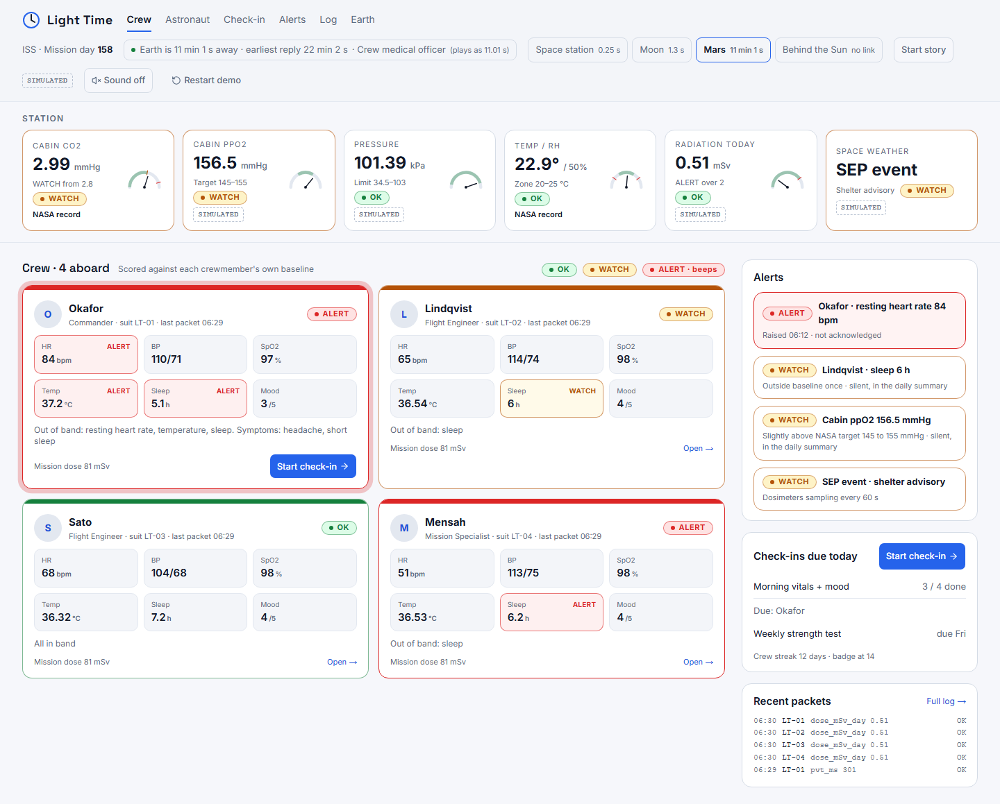
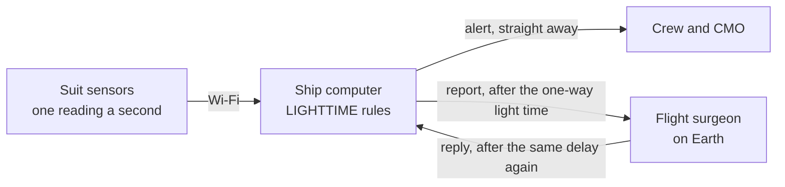

# LIGHT-TIME backend

LIGHT-TIME is crew health monitoring that knows how far away Earth is. It works out how long a falling reading has left, compares that with the time a reply from Earth needs, and tells the crew who has to act. It was built for the NASA Space Apps Challenge 2026, challenge "Create Health Monitoring Software for Astronauts on Space Missions".

- Live demo: https://lighttime.health (one shared demo ship; Restart demo takes it back to the start)
- The console, with the crew and Earth screens: https://github.com/NASA-space-apps-the-procrastinators/LightTime-frontend
- The concept, with the math explained step by step: [docs/concept.pdf](docs/concept.pdf)
- The research paper (draft): [paper/main.pdf](paper/main.pdf)

## The idea

A message from the space station reaches the flight surgeon on Earth and comes back in half a second. From Mars on 14 November 2026 the round trip takes 22 minutes (11 minutes each way; over the years the one-way time runs from about 3 to 22 minutes), and behind the Sun there is no link at all. Monitoring software for that trip can't assume a doctor is a second away. LIGHT-TIME checks each reading as it arrives, raises an alert only on readings it can trust, and says plainly who acts: the flight surgeon on Earth, the crew medical officer (CMO) on board, or the crew alone.

## Suit, ship and Earth

### The suit

Each crew member wears a smart shirt like the Canadian Space Agency's Bio-Monitor. Our design, not yet built, is an ESP32 microcontroller reading a MAX30102 heart-rate and blood-oxygen sensor, a MAX30205 skin-temperature sensor, an MPU6050 motion sensor, two MyoWare 2.0 muscle sensors and a SPACEDOS02 radiation dosimeter, with a Bluetooth blood-pressure cuff for the daily check-in. It posts one reading a second to `POST /api/base/readings` in the format described in [docs/hardware.md](docs/hardware.md). In the demo these readings are simulated.

### The ship

This repository. LIGHTTIME throws out readings that can't be real, holds each alert level for five clean readings in a row, and compares each person with their own usual range. For a falling blood-oxygen reading it fits a Theil-Sen trend line, works out the seconds left before the red line, compares that with the round trip to Earth, and says who acts. An SOS goes to the whole crew with who and what; the full record stays with the CMO.

### Earth

A report leaves the moment the ship raises an early warning or an SOS. Routine vitals go every two minutes once the feed is started, and a summary goes once a day. Each message arrives after the one-way light time, stamped with when it left and the earliest a reply can come back. The light time is the Earth-Mars distance from NASA JPL Horizons for the mission date, divided by the speed of light.

LIGHTTIME is fixed rules and simple statistics. No trained model decides anything, and no language model runs in the app.

## Run it

    python -m venv .venv
    source .venv/bin/activate            # Windows: .venv\Scripts\activate
    pip install -r requirements.txt
    python -m pytest -q                  # 236 tests
    LIGHTTIME_MORNING=1 python app.py    # Windows PowerShell: $env:LIGHTTIME_MORNING = '1'; python app.py

The ship answers at http://localhost:5000/api/base/state. With `LIGHTTIME_MORNING=1` it starts on the demo morning, 14 November 2026 at 06:30 UTC, and every reset goes back there. Run one process only, because the mission clock lives in its memory. The server does not reload on its own, so restart it after a change.

It uses a local SQLite file unless `DATABASE_URL` is set. For Postgres, copy `.env.example` to `.env` and set `DATABASE_URL` there; `.env` is git-ignored.

To see it, start the console from the `LightTime-frontend` repository with `NEXT_PUBLIC_API_URL=http://localhost:5000` in its `.env.local`, then run `corepack pnpm install` and `corepack pnpm dev`, and open http://localhost:3000. Docker and Google Cloud are covered in [the deployment tutorial](docs/deployment.md).

## Run with Docker

    docker build -t lighttime-backend .
    docker run --rm -p 8080:8080 -e LIGHTTIME_MORNING=1 lighttime-backend

The container listens on port 8080 (Cloud Run supplies `PORT`), runs as a non-root user, and starts gunicorn with one worker so there is one mission clock. Add `--env-file .env` to use Postgres.

## Repository layout

| Path | What it holds |
|---|---|
| `base_station/` | The ship: readings, rules, alerts, reports and the scripted story. Serves `/api/base` |
| `command_center/` | The Earth console's API: cases, replies and the vitals feed. Serves `/api/earth`, and may read only the link, never the ship's tables (`tests/test_wall.py` checks this) |
| `common/` | Shared parts: tables, the delayed link, Mars light time and the who-decides rule |
| `tests/` | 236 automated tests |
| `data/` | The reference data, the simulated mission month and the public test recordings, with the scripts that build them ([details](docs/tech/data.md)) |
| `scripts/` | Data checks, the API reference generator, the docs checker, and the scripts that write every number and figure in the paper |
| `paper/` | The research paper's LaTeX source and PDF |
| `docs/` | The documentation; start at [docs/index.md](docs/index.md) |
| `docs/build-log/` | The weekend's build plans, reviews and hand-off notes, kept for transparency |

The folder names use underscores because Python cannot import a folder with a hyphen in its name.

## Documentation

| Read this | For |
|---|---|
| [Concept](docs/concept.md) ([PDF](docs/concept.pdf)) | The idea, the terms, the math and a glossary |
| [Research paper](paper/main.pdf) | The decision rules, how they were checked on public recordings, and the limits |
| [Architecture](docs/tech/architecture.md) | Hosting, the parts, the tables, the path of one reading, the life of an alert |
| [API reference](docs/tech/api.md) | Every route with an example answer, generated from the running app |
| [Security and privacy](docs/tech/security-privacy.md) | What the demo protects and what it does not |
| [Operations](docs/tech/operations.md) | Health, reset, the story, the dial, logs and rolling back |
| [How it works](docs/how-it-works.md) | The evidence from real recordings and its limits |
| [Submission text](docs/submission.md) | Copy-ready text for each field of the project page |

The API contract the console builds against is the API table in [docs/specs/2026-11-14-backend-design.md](docs/specs/2026-11-14-backend-design.md). Change that table in the same commit as any route or field.

## Data and honesty notes

- Mars light time is the distance from NASA JPL Horizons divided by the speed of light. If Horizons cannot be reached, dated values read on 13 November are used and labelled. `python scripts/verify_data.py` checks the light-time numbers against Horizons and NASA's Deep Space Network Now feed, along with the alert bands, the clean tables and the raw-file checksums.
- The crew's vital signs, the mission month and the story are simulated, and the screens say so. Only the test recordings are real, and they come from volunteers on Earth.
- The alert tiers (caution, warning, emergency) are inspired by the NEWS2 chart (Royal College of Physicians, 2017), a hospital score that has not been checked in spaceflight.
- We assume the crew wear the shirt for the whole mission.
- The views are role-based, not a login, and the hosted demo still has gaps. [Security and privacy](docs/tech/security-privacy.md) lists each one with where it is in the code.
- Checklist wording in `base_station/procedures.json` is demo text, not medical advice.

## AI use

AI assistants (Claude and Claude Code) helped plan, write and review the code, the tests and the documents. Every use on the backend is logged with its date and purpose in [AI_USE.md](AI_USE.md), and the plans they helped write are in [docs/build-log](docs/build-log/). The app itself calls no AI model.

## Licence

No licence file has been added yet. The team has to choose one before the repositories are made public; until then the code is all rights reserved.
