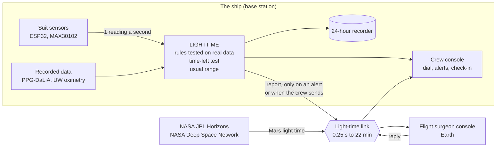

# Connect Everything: LIGHTTIME, the Console and the Earth Link

> **For agentic workers:** REQUIRED SUB-SKILL: Use superpowers:executing-plans to implement this plan task-by-task. Steps use checkbox (`- [ ]`) syntax for tracking.

**Goal:** One working system tonight: the crew console shows the ship AI's live alerts, the distance dial and the round trip to Earth, a second screen is the Earth console, and the suit sensor feeds the same backend.

**Architecture:** The backend stays as built (110 tests). The frontend keeps every screen already built and gains a live layer beside it: one provider that polls the backend, one bar (the dial), one panel (the ship AI's alerts), one new page (Earth). Live mode switches on only when `NEXT_PUBLIC_API_URL` is set, so the seeded demo keeps working without the backend.

**Tech Stack:** Backend: Python 3.13, Flask, pytest. Frontend: Next.js 16, React 19, TypeScript, Tailwind, shadcn, Biome, pnpm.

**Superseded in part, Saturday evening.** The frontend owner wrote an API contract and is wiring his own screens, and a generated dataset arrived. What that changes here:

| Task | Now |
|---|---|
| 0, fictional crew | Replaced by Task 2 of `docs/plans/2026-11-14-console-contract.md` (four crew from the dataset) |
| 1, LIGHTTIME by name | Still to do, as Task 11 of that plan. The steps below are the ones to follow, with the three differences that task lists |
| 2 and 3, live layer and panel | Not being built. The console reads the API directly |
| 4, Earth console page | Not built and still needed. A draft only: it must be re-pointed at the console's current structure. Open question Q1 in `docs/specs/2026-11-14-console-data-design.md` |
| 5, 6, 7, 8 | Stand as written. In Task 5 the suit may send `crew_id` as `C2` or `2` |

**Status of this plan:** written at 16:30 on Saturday without running anything. All code is untested. Run every check. Frontend tasks go on a branch and end in a pull request for the frontend owner.

---

## Part A: what was found

### A1. Where everything stands at 16:15

| Piece | State |
|---|---|
| Backend | Tonight's plan is built and pushed: 110 tests, 25 routes, typed client in `docs/frontend/`, data checks, held-out result written into the spec |
| Frontend | A full base-station console is merged: crew cards, alerts rail, astronaut detail with body map and trend chart, morning check-in with reaction test, log |
| Connection between them | **None.** The console runs on `crew-seed.json`, its own `scoring.ts` and `localStorage`. It never calls the backend |
| Earth console | Does not exist in the frontend. No `command-center` route |
| Distance dial | Does not exist in the frontend. The seed says ISS, 0.6 s |
| Hardware | The suit design: ESP32 reading a MAX30102 (heart rate and blood oxygen), muscle activity, radiation, a Bluetooth cuff, sent over Wi-Fi to the base station |

So the team has two good halves of two different demos. The console's is the slow story: a resting heart rate drifting for three days, caught at the morning check-in, on the ISS. The backend's is the fast story: blood oxygen falling at Mars, where Earth cannot answer in time. The idea that names the project (the dial, the delay, who decides) is only in the backend.

### A2. How they differ, and what each difference costs

| | Frontend | Backend | What to do |
|---|---|---|---|
| Crew | Okafor, Lindqvist, Sato, Mensah (`C1` to `C4`) | Three crew named after team members (1 to 3) | Task 0 renames them Okafor, Lindqvist, Sato, so both halves match |
| States | OK, WATCH, ALERT | nominal, advisory, caution, warning, emergency | Map in one place: emergency shows as ALERT with the label SOS |
| Alert steps | raised, acknowledged, sent, replied, resolved | `timeline` with the same five times | Same shape. No conflict |
| Scoring | In the browser, against each person's baseline | On the ship, tested on real recordings | Keep both, each for its own story (A3) |
| Heart rate | Alerts at baseline + 20 for three days | Never alerts alone | These agree: both say one reading means nothing, days of drift mean something |
| Reply from Earth | Canned text, appears on a button | Real message, arrives after the light delay | Live panel uses the real one |
| Mars delay | "4 to 24 min" in the seed | 3 to 22 (JPL) | Fix the seed number, one line, the frontend owner's call |
| Service | The packet schema expects a Node service with WebSocket | Flask, polled once a second | Do not build a second service. Polling is enough for a demo |

### A3. The product in one sentence, after this plan

Two speeds of trouble, one console: the slow drift is caught at the morning check-in against the person's own baseline (the existing screens), the fast fall is caught by the ship AI, which knows how far Earth is and says who has to act (the new live layer).

This framing is the cheapest way to connect the work, because nothing already built is thrown away or rewritten.

### A4. The ship AI is called LIGHTTIME

It carries the project's name because it is the part that knows how long the light takes, and so knows who has to act. In the design brainstorm it is the "Med bay AI" box on the base station. The voice says "Light Time".

It has four parts, named as in the design diagram:

| Part | What it does | Built |
|---|---|---|
| Don't cry wolf | Throws out junk signal and holds every alarm rule to a test on real recordings | Yes |
| Know each person | Learns each person's usual range from their own last 24 hours | Yes, heart rate. Shown, never alarms |
| Time left | Works out how long until a falling reading is critical, and whether Earth can answer first | Yes |
| Ask ahead | Answers the flight surgeon's first questions before the report leaves | Yes |
| Med bay voice | Says the alert out loud from fixed templates, with the rule and its source | Templates yes. An offline language model: no, and not tonight |

Its role changes with the distance: near Earth it drafts and the flight surgeon directs, far out it coaches the crew medical officer, in a blackout it is the main reference. It suggests and never decides. Task 1 puts the name, the four parts, a rules version and that role into the API.

It trains no model and calls no language model. How strong the evidence is:

| Claim | Evidence | Weakness |
|---|---|---|
| Warns before the red line | 6 of 6 volunteers, also 6 of 6 when the settings were chosen without the volunteer being tested (median 97 s ahead) | Six people, one lab, one slow kind of fall. The shortest warning was 14 s |
| Time-left estimate is usable | Within a factor of two on all six | It was off by 50 s on a 106 s warning. Show it as "about" |
| Few false warnings | 2 in 7.8 hours of a healthy sleeper, 0 false SOS after cleaning | One sleeper. No awake, moving person tested |
| Works on fast falls | Came first in 32% of 579 falls in a sleep apnoea patient | For the other 68% the fixed rule does the work |
| Works on our own sensor | **Not tested.** All evidence is from clinical finger oximeters | A MAX30102 on a fingertip is noisier. Task 6 tests it tonight |

Where to put the remaining hours, ranked by what a judge will see against how likely it is to work: (1) the dial and the live alert on the console, (2) the Earth console, (3) the hardware feeding one crew tile, (4) the evidence figure for the pitch. A learned model is last and is not in this plan.

Three specs go with this plan, in `docs/specs/`: `2026-11-14-lighttime-ai-design.md` (the ship AI), `2026-11-14-console-link-design.md` (console, ship and Earth), `2026-11-14-suit-data-design.md` (the suit and its data).

### A5. The two documents you attached

- **Hardware (ESP32 DevKitC, MAX30102 SEN0518).** Fits the backend as it is: the ESP32 posts JSON to `POST /api/base/readings` once a second. Heart rate and blood oxygen are stored and judged. Muscle activity and radiation have no column and are not stored tonight. Task 5 writes the one-page contract for the suit.
- **Food intake tracking.** Not tonight. It needs a new table, a new screen and a reason to exist in the pitch. If it matters on Sunday, the cheapest honest version is one free-text line in the morning check-in note.

---

## Part B: the short spec

**Problem.** A crew far from Earth cannot wait for a doctor. The console that shows their health and the computer that knows the distance are two programs that do not talk.

**Goals for tonight**
1. Changing the dial on the console changes who decides, on every screen, within a second.
2. A falling reading produces one alert that shows on the console with its reason, its countdown and the earliest possible reply from Earth.
3. A second laptop shows the Earth console, and hears nothing until the light delay has passed.
4. A reading from the suit sensor appears on a crew tile.
5. With the backend switched off, the seeded demo still runs.

**Not doing:** rewriting the console's scoring, a Node service, WebSocket, login, food tracking, a learned model, storing muscle activity or radiation from the suit.

**Who uses it**
- As the crew medical officer, I want the alert to tell me whether to wait for Earth or act, so I do not lose minutes deciding.
- As the flight surgeon, I want the report to already answer my first questions, so my one reply counts.
- As a crew member, I want to see exactly what has left the ship about me, so I can trust being monitored.

**Must have (P0):** fictional crew (Task 0), LIGHTTIME in the API (Task 1), live provider and dial bar (Task 2), live alert panel (Task 3), Earth console page (Task 4), run-through (Task 8).
**Should have (P1):** hardware contract and sensor test (Tasks 5, 6), evidence figure and system diagram (Task 7).
**Later (P2):** live vitals on the crew cards, check-in posted to the backend, the seeded alert sent through the real link.

**Done means:** the nine lines of the run-through in Task 8 pass on two laptops.

**Open questions**
- Frontend owner: are two small edits to existing files acceptable tonight (Task 2 Step 5, Task 3 Step 3)? Blocking.
- Hardware owner: can the ESP32 reach the backend laptop's IP on the venue Wi-Fi? Blocking for goal 4 only.

---

## File map

| Repo | File | New or changed | What it does |
|---|---|---|---|
| backend | `common/modes.py`, `base_station/routes.py` | changed | The ship AI's name in `/state` |
| backend | `tests/test_contract.py`, `tests/test_tonight.py` | changed | One new test, one set updated |
| backend | `docs/frontend/lighttime-api.ts` | changed | `ship_ai` in the type |
| backend | `docs/hardware.md` | new | The suit's contract |
| backend | `scripts/make_figures.py`, `docs/figures/` | new | Evidence figure |
| backend | `docs/system.md` | new | System diagram |
| frontend | `src/lib/lighttime-api.ts`, `src/lib/use-poll.ts` | new (copied) | Typed client, polling hook |
| frontend | `src/lib/live.tsx` | new | One provider that polls the ship |
| frontend | `src/components/base-station/lighttime-bar.tsx` | new | The dial |
| frontend | `src/components/base-station/lighttime-panel.tsx` | new | The ship AI's alerts |
| frontend | `src/app/command-center/page.tsx` | new | Earth console |
| frontend | `src/app/base-station/layout.tsx`, `page.tsx` | changed | Two small insertions |

---

### Task 0 (backend): Fictional crew

The three seeded crew are named after people on the team. The console's seed uses fictional names. Use those, so both halves show the same crew and no real name is on screen.

- [ ] **Step 1:** Run `python -m pytest -q`. Expected: `110 passed`. If not, stop and report it.
- [ ] **Step 2:** Open `seed()` in `common/models.py`. Rename crew 1, 2 and 3 to `Okafor`, `Lindqvist` and `Sato`. Keep their roles. Then replace the same three old names wherever they appear in `tests/`, `base_station/` and `scripts/` (test expectations, spoken lines, a sorted list of names). Use search and replace, one name at a time, and read the diff.
- [ ] **Step 3:** Run `python -m pytest -q`. Expected: `110 passed`. A test that lists the crew in alphabetical order should now read Lindqvist, Okafor, Sato.
- [ ] **Step 4: Databases.** Local SQLite: `rm -f instance/lighttime.db`. The hosted Postgres already holds the old rows, so once:

`python -c "from app import create_app; from common.models import db; a = create_app(); a.app_context().push(); db.session.execute(db.text(\"UPDATE crew SET name = CASE id WHEN 1 THEN 'Okafor' WHEN 2 THEN 'Lindqvist' ELSE 'Sato' END\")); db.session.commit()"`

- [ ] **Step 5:** Commit: `chore: fictional crew names`.

---

### Task 1 (backend): LIGHTTIME by name, with its parts, its role and its reasoning

Spec: `docs/specs/2026-11-14-lighttime-ai-design.md`, requirements A1 to A5.

- [ ] **Step 1:** Add to the end of `tests/test_tonight.py`:

```python
def test_the_ship_ai_introduces_itself(client):
    ship_ai = client.get("/api/base/state").get_json()["ship_ai"]
    assert ship_ai["name"] == "LIGHTTIME" and ship_ai["version"].startswith("rules ")
    assert [part["name"] for part in ship_ai["parts"]] == ["Don't cry wolf", "Know each person", "Time left", "Ask ahead"]


def test_its_role_changes_with_the_distance(client):
    role = {}
    for where in ("station", "mars", "sun"):
        role[where] = client.post("/api/base/dial", json={"stop": where}).get_json()["state"]["ship_ai_role"]
    assert role["station"].startswith("Drafts") and role["mars"].startswith("Coaches")
    assert role["sun"].startswith("Main reference")


def test_the_report_carries_the_reasoning_and_how_steady_the_fall_is(client):
    for i in range(30):
        client.post("/api/base/readings", json={"crew_id": 1, "spo2": round(98 - 0.1 * i, 1)})
    payload = client.get("/api/base/outbox").get_json()[0]["payload"]
    assert payload["why"][0].startswith("What was seen")
    assert 0.5 <= payload["lookahead"]["agreement"] <= 1


def test_the_alert_names_the_next_step(client):
    alert = sos(client)
    assert alert["next_step"] == alert["steps"][0]
    after = client.post(f"/api/base/alerts/{alert['id']}/steps", json={"index": 0}).get_json()
    assert after["next_step"] == alert["steps"][1]
```

In `tests/test_contract.py`: add `"ship_ai_role"` to the `STOP` set, add `"next_step"` to the `ALERT` set, and change `STOP | {"speedup", "stops"}` to `STOP | {"speedup", "stops", "ship_ai"}`.

- [ ] **Step 2:** Run `python -m pytest -q`. Expected: 5 failed, 109 passed.
- [ ] **Step 3:** In `common/modes.py`, below `WHO_DECIDES`, add:

```python
SHIP_AI = {
    "name": "LIGHTTIME",
    "line": "It knows how long the light takes, so it knows who has to act.",
    "version": "rules 2026-11-14",
    "parts": [
        {"name": "Don't cry wolf", "does": "Throws out junk signal. Every alarm rule was first tried on real recordings."},
        {"name": "Know each person", "does": "Learns each person's usual range from their own last 24 hours."},
        {"name": "Time left", "does": "Works out how long until a falling reading is critical, and whether Earth can answer first."},
        {"name": "Ask ahead", "does": "Answers the flight surgeon's first questions before the report leaves."},
    ],
}
ROLE = {
    "doctor_live": "Drafts the report. The flight surgeon directs care.",
    "crew_first": "Coaches the crew medical officer. Earth reviews afterwards.",
    "ship_alone": "Main reference until the link returns. Everything is kept for Earth.",
}
```

and in `describe`, add one entry to the returned dict:

```python
        "ship_ai_role": ROLE[mode],
```

- [ ] **Step 4:** In `base_station/routes.py`, in the `state` route after `out["speedup"] = link.SPEEDUP`, add:

```python
    out["ship_ai"] = modes.SHIP_AI
```

In `alert_dict`, before the `return`, add:

```python
    todo = [step for index, step in enumerate(reports.steps_for(alert.vital)) if index not in alert.steps_done]
```

and add one entry to the returned dict:

```python
        "next_step": todo[0] if todo else None,
```

- [ ] **Step 5:** In `base_station/lookahead.py`, in `falling`, change the last line to:

```python
    return {"now": round(now, 1), "per_min": round(slope * 60, 1), "eta_s": round(eta_s), "red_line": red_line,
            "agreement": round(agreement, 2)}
```

In `base_station/reports.py`, in `build`, add one entry to the returned dict, before `"asked_ahead"`:

```python
        "why": why(alert),
```

- [ ] **Step 6:** In `docs/frontend/lighttime-api.ts`: add `ship_ai_role: string;` to `StopState`, add `agreement: number;` to `Lookahead`, add `next_step: string | null;` to `Alert`, and change the `MissionState` line to:

```ts
export interface MissionState extends StopState {
  speedup: number; stops: StopState[];
  ship_ai: { name: string; line: string; version: string; parts: { name: string; does: string }[] };
}
```

- [ ] **Step 7:** Run `python -m pytest -q`. Expected: `114 passed`. Add the four new fields to the API table in `docs/specs/2026-11-14-backend-design.md`. Commit: `feat: LIGHTTIME by name, with its parts, role and reasoning`. Push.

---

### Task 2 (frontend): The live layer and the dial

Work in `LightTime-frontend`. The repo's `AGENTS.md` says this Next.js version differs from older ones: read the guide it points to before editing a page or layout.

- [ ] **Step 1: Branch.** Run `git status --short`. If files show as modified, they are not yours: stop and ask whether to stash them. Then `git fetch`, `git switch -c feat/lighttime-live origin/main`, `pnpm install`.
- [ ] **Step 2: Copy the client.** Copy `docs/frontend/lighttime-api.ts` and `docs/frontend/use-poll.ts` from the backend repo into `src/lib/`.
- [ ] **Step 3: Create `src/lib/live.tsx`:**

```tsx
"use client";

import { createContext, type ReactNode, useContext, useEffect, useState } from "react";
import {
  type Alert, api, type CrewMember, type Habitat, type LinkMessage, type MissionState, speakOnce,
} from "@/lib/lighttime-api";

/** Live mode is on only when the backend address is set. Without it the seeded demo runs alone. */
export const LIVE = Boolean(process.env.NEXT_PUBLIC_API_URL);

type Live = {
  state: MissionState | null; crew: CrewMember[]; alerts: Alert[];
  outbox: LinkMessage[]; inbox: LinkMessage[]; habitat: Habitat | null; error: string | null;
};
const EMPTY: Live = { state: null, crew: [], alerts: [], outbox: [], inbox: [], habitat: null, error: null };
const LiveContext = createContext<Live>(EMPTY);

export function LiveProvider({ children }: { children: ReactNode }) {
  const [live, setLive] = useState<Live>(EMPTY);
  useEffect(() => {
    if (!LIVE) return;
    let on = true;
    const tick = async () => {
      try {
        const [state, crew, alerts, outbox, inbox, habitat] = await Promise.all([
          api.state(), api.crew(), api.alerts(), api.outbox(), api.inbox(), api.habitat(),
        ]);
        if (!on) return;
        for (const alert of alerts) speakOnce(alert);
        setLive({ state, crew, alerts, outbox, inbox, habitat, error: null });
      } catch (problem) {
        if (on) setLive((old) => ({ ...old, error: String(problem) }));
      }
    };
    void tick();
    const timer = setInterval(tick, 1000);
    return () => {
      on = false;
      clearInterval(timer);
    };
  }, []);
  return <LiveContext.Provider value={live}>{children}</LiveContext.Provider>;
}

export const useLive = () => useContext(LiveContext);

/** Mission seconds as words: "0.3 s", "45 s", "11 min". */
export function span(seconds: number): string {
  if (seconds < 10) return `${seconds.toFixed(1)} s`;
  return seconds < 90 ? `${Math.round(seconds)} s` : `${Math.round(seconds / 60)} min`;
}

/** Whole seconds from now until an ISO time, never below zero. */
export function secondsUntil(iso: string): number {
  return Math.max(0, Math.round((Date.parse(iso) - Date.now()) / 1000));
}
```

- [ ] **Step 4: Create `src/components/base-station/lighttime-bar.tsx`:**

```tsx
"use client";

import { Button } from "@/components/ui/button";
import { api } from "@/lib/lighttime-api";
import { LIVE, span, useLive } from "@/lib/live";

/** The distance dial. Turning it changes the delay and who decides, for every screen. */
export function LightTimeBar() {
  const { state, error } = useLive();
  if (!LIVE) return null;
  if (!state) {
    return (
      <div className="border-b px-4 py-2 text-xs text-muted-foreground md:px-8">
        {error ? `Ship computer not reachable (${error})` : "Connecting to the ship computer"}
      </div>
    );
  }
  return (
    <div className="flex flex-wrap items-center gap-x-4 gap-y-2 border-b px-4 py-2 text-sm md:px-8">
      <strong className="font-heading" title={state.ship_ai.line}>{state.ship_ai.name}</strong>
      <fieldset className="inline-flex overflow-hidden rounded-md border">
        <legend className="sr-only">Distance from Earth</legend>
        {state.stops.map((s) => (
          <button
            key={s.stop}
            type="button"
            aria-pressed={s.stop === state.stop}
            onClick={() => void api.dial(s.stop)}
            className={s.stop === state.stop ? "bg-primary px-3 py-1 text-primary-foreground" : "px-3 py-1"}
          >
            {s.label}
          </button>
        ))}
      </fieldset>
      <span>
        {state.link_up
          ? `${span(state.delay_s)} one way, ${span(state.round_trip_s)} round trip, ${state.path_km.toLocaleString()} km`
          : "No link to Earth"}
      </span>
      <span className="font-medium">Decides: {state.who_decides}</span>
      <span className="text-xs">{state.ship_ai_role}</span>
      <span className="text-xs text-muted-foreground">
        {state.light_time_source}
        {state.link_up && state.delay_s >= 60 ? `, playing ${state.speedup}x faster` : ""}
      </span>
      <span className="ml-auto inline-flex gap-2">
        <Button size="sm" variant="outline" onClick={() => void api.startStory("stage")}>Play fast fall</Button>
        <Button size="sm" variant="outline" onClick={() => void api.startStory("real")}>Play recorded fall</Button>
        <Button size="sm" variant="outline" onClick={() => void api.reset()}>Clear</Button>
      </span>
    </div>
  );
}
```

- [ ] **Step 5: Put both into the base-station layout.** Replace `src/app/base-station/layout.tsx` with:

```tsx
import { AppHeader } from "@/components/base-station/app-header";
import { ConsoleAlarm } from "@/components/base-station/console-alarm";
import { LightTimeBar } from "@/components/base-station/lighttime-bar";
import { LiveProvider } from "@/lib/live";

export default function BaseStationLayout({
  children,
}: LayoutProps<"/base-station">) {
  return (
    <LiveProvider>
      <div className="flex min-h-full flex-1 flex-col">
        <ConsoleAlarm />
        <AppHeader />
        <LightTimeBar />
        <main className="flex flex-1 flex-col">{children}</main>
      </div>
    </LiveProvider>
  );
}
```

- [ ] **Step 6: Check.** Create `.env.local` with `NEXT_PUBLIC_API_URL=http://localhost:5000`. Start the backend (`python app.py`), then `pnpm dev`, and open `/base-station`.
Expected: under the header a bar reading LIGHTTIME, four stops, a line saying what the ship AI's role is at this distance, "0.3 s one way" and "Decides: Flight surgeon on Earth". Click Mars: "11 min one way, 22 min round trip", "Decides: Crew medical officer". Remove `.env.local`, restart: the bar is gone and the seeded console is unchanged.
- [ ] **Step 7:** `pnpm lint:fix && pnpm typecheck`. Fix what they report without changing behaviour. Commit: `feat: live layer and distance dial`.

---

### Task 3 (frontend): LIGHTTIME's alerts on the console

- [ ] **Step 1: Create `src/components/base-station/lighttime-panel.tsx`:**

```tsx
"use client";

import { useState } from "react";
import { StatePill } from "@/components/shared/state-pill";
import { Button } from "@/components/ui/button";
import { type Alert, api, LEVEL_LABEL, type LinkMessage } from "@/lib/lighttime-api";
import { LIVE, secondsUntil, span, useLive } from "@/lib/live";

const PILL = { OK: "OK", WATCH: "WATCH", ALERT: "ALERT", SOS: "ALERT" } as const;
const clock = (iso: string | null) => (iso ? new Date(iso).toLocaleTimeString() : "not yet");

function Countdown({ alert }: { alert: Alert }) {
  const look = alert.lookahead;
  const line = alert.timeline;
  return (
    <div className="grid gap-1 text-sm">
      {look && alert.level !== "emergency" && (
        <p>
          Red line ({look.red_line}%) in about <strong>{span(secondsUntil(look.red_line_at))}</strong>, falling{" "}
          {Math.abs(look.per_min)} a minute.{" "}
          {look.reply_s === null
            ? "No link to Earth."
            : look.earth_in_time
              ? `Earth can answer in ${span(look.reply_s)}.`
              : `Earth's earliest reply is ${span(look.reply_s)} away. Too late: the crew acts.`}
        </p>
      )}
      {line.sent_at && !line.reply_at && line.earliest_reply_at && (
        <p className="text-muted-foreground">
          Report {line.earth_at ? "reached Earth" : `reaches Earth in ${span(line.earth_eta_s ?? 0)}`}. Earliest
          reply lands in {secondsUntil(line.earliest_reply_at)} s on this screen.
        </p>
      )}
      {!line.sent_at && <p className="text-muted-foreground">Nothing about this has left the ship.</p>}
    </div>
  );
}

function AlertCard({ alert, replies }: { alert: Alert; replies: LinkMessage[] }) {
  const [by, setBy] = useState("Crew medical officer");
  const [note, setNote] = useState("");
  const label = LEVEL_LABEL[alert.level];
  return (
    <article className="grid gap-3 rounded-lg border p-4">
      <header className="flex flex-wrap items-center gap-2">
        <StatePill state={PILL[label]} label={label} />
        <h3 className="font-heading font-semibold">{alert.crew}: {alert.reason}</h3>
        <span className="ml-auto text-xs text-muted-foreground">{alert.nasa_risk}</span>
      </header>
      {alert.speak && <p className="text-sm font-medium">{alert.speak}</p>}
      {alert.next_step && <p className="text-sm">Next: {alert.next_step}</p>}
      <Countdown alert={alert} />
      <ol className="grid gap-1 text-sm">
        {alert.steps.map((step, index) => (
          <li key={step}>
            <label className="flex items-center gap-2">
              <input
                type="checkbox"
                checked={alert.steps_done.includes(index)}
                disabled={alert.steps_done.includes(index)}
                onChange={() => void api.tickStep(alert.id, index)}
              />
              {step}
            </label>
          </li>
        ))}
      </ol>
      <details className="text-sm">
        <summary className="cursor-pointer font-medium">Why the ship raised this</summary>
        <ul className="mt-1 list-disc pl-5 text-muted-foreground">
          {alert.why.map((reason) => (
            <li key={reason}>{reason}</li>
          ))}
        </ul>
      </details>
      <p className="text-xs text-muted-foreground">
        Raised {clock(alert.timeline.raised_at)} · acknowledged {clock(alert.timeline.acknowledged_at)} · sent{" "}
        {clock(alert.timeline.sent_at)} · Earth heard {clock(alert.timeline.earth_at)} · reply{" "}
        {clock(alert.timeline.reply_at)}
      </p>
      {replies.map((reply) => (
        <p key={reply.id} className="rounded-md border p-2 text-sm">
          <strong>{String(reply.payload.from ?? "Earth")}:</strong> {String(reply.payload.text ?? "")}
        </p>
      ))}
      <div className="flex flex-wrap items-center gap-2">
        <input
          aria-label="Your name"
          value={by}
          onChange={(event) => setBy(event.target.value)}
          className="w-44 rounded-md border px-2 py-1 text-sm"
        />
        {!alert.acknowledged_by && (
          <Button size="sm" onClick={() => void api.acknowledge(alert.id, by)}>Acknowledge</Button>
        )}
        {!alert.timeline.sent_at && (
          <Button size="sm" variant="outline" onClick={() => void api.sendToEarth(alert.id)}>
            Send to flight surgeon
          </Button>
        )}
        <input
          aria-label="What you did and why, in your own words"
          placeholder="What you did and why"
          value={note}
          onChange={(event) => setNote(event.target.value)}
          className="min-w-48 flex-1 rounded-md border px-2 py-1 text-sm"
        />
        <Button size="sm" variant="outline" disabled={!note.trim()} onClick={() => void api.resolve(alert.id, by, note)}>
          Resolve
        </Button>
      </div>
    </article>
  );
}

/** Live alerts from the ship AI, shown above the seeded console. Nothing renders without the backend. */
export function LightTimePanel() {
  const { state, alerts, inbox, outbox } = useLive();
  if (!LIVE || !state) return null;
  return (
    <section aria-label={`${state.ship_ai.name} alerts`} className="grid gap-3 px-4 pt-6 md:px-8">
      <div className="flex flex-wrap items-baseline gap-3">
        <h2 className="font-heading text-[17px] font-semibold">{state.ship_ai.name}</h2>
        <span className="text-xs text-muted-foreground">
          {alerts.length === 0 ? "Watching. Nothing to report." : `${alerts.length} open`} · {outbox.length} message
          {outbox.length === 1 ? " has" : "s have"} left the ship
        </span>
        <Button size="sm" variant="outline" className="ml-auto" onClick={() => void api.sos(1)}>Press SOS</Button>
      </div>
      {alerts.map((alert) => (
        <AlertCard
          key={`${alert.id}:${alert.at}`}
          alert={alert}
          replies={inbox.filter((m) => m.payload.alert_id === alert.id && m.kind === "reply")}
        />
      ))}
    </section>
  );
}
```

- [ ] **Step 2: Check the pill.** Open `src/components/shared/state-pill.tsx`. This code passes `state` (OK, WATCH or ALERT) and `label`. If its props are named differently, change the one `StatePill` line here to match. Do not change that component.
- [ ] **Step 3: Show it.** In `src/app/base-station/page.tsx`, add the import `import { LightTimePanel } from "@/components/base-station/lighttime-panel";` and put `<LightTimePanel />` on the line after `<StationStrip />`.
- [ ] **Step 4: Check.** With both servers running: dial Mars, press "Play fast fall".
Expected within 10 s: a card "Okafor: Blood oxygen 86%, out of range for 5 s" with the label SOS, the spoken line (once), a checklist, "Why the ship raised this", and "Earliest reply lands in N s" counting down from about 22. Tick the second step: the story recovers. Type a note and press Resolve: the card goes.
Then "Clear", "Play recorded fall" and wait about a minute and a half: a WATCH or ALERT card with "Too late: the crew acts" and a red-line countdown.
- [ ] **Step 5:** `pnpm lint:fix && pnpm typecheck`. Commit: `feat: LIGHTTIME alert panel`.

---

### Task 4 (frontend): The Earth console

- [ ] **Step 1: Create `src/app/command-center/page.tsx`:**

```tsx
"use client";

import { useState } from "react";
import { Button } from "@/components/ui/button";
import { api, type LinkMessage } from "@/lib/lighttime-api";
import { span } from "@/lib/live";
import { usePoll } from "@/lib/use-poll";

type Answer = { q: string; a: string };
const text = (value: unknown) => (typeof value === "string" ? value : "");

function Report({ message }: { message: LinkMessage }) {
  const [reply, setReply] = useState("");
  const payload = message.payload;
  const sbar = (payload.sbar ?? {}) as Record<string, string>;
  const answers = (payload.asked_ahead ?? []) as Answer[];
  return (
    <article className="grid gap-2 rounded-lg border p-4">
      <h3 className="font-heading font-semibold">
        {text(payload.level).toUpperCase()} · {text(payload.crew)}: {text(payload.reason)}
      </h3>
      <p className="text-sm">{sbar.situation} {sbar.background}</p>
      <p className="text-sm text-muted-foreground">{sbar.assessment} {sbar.request}</p>
      {answers.length > 0 && (
        <dl className="grid gap-1 text-sm">
          {answers.map((item) => (
            <div key={item.q}>
              <dt className="font-medium">{item.q}</dt>
              <dd className="text-muted-foreground">{item.a}</dd>
            </div>
          ))}
        </dl>
      )}
      <div className="flex gap-2">
        <input
          aria-label="Reply to the ship"
          placeholder="Reply to the ship"
          value={reply}
          onChange={(event) => setReply(event.target.value)}
          className="flex-1 rounded-md border px-2 py-1 text-sm"
        />
        <Button
          size="sm"
          disabled={!reply.trim()}
          onClick={() => void api.earthReply(reply, message.id).then(() => setReply(""))}
        >
          Send
        </Button>
      </div>
    </article>
  );
}

export default function CommandCenterPage() {
  const { data: inbox, error } = usePoll(api.earthInbox);
  const { data: sent } = usePoll(api.earthOutbox);
  const { data: network } = usePoll(api.network, 30_000);
  if (!inbox) {
    return <main className="p-8 text-sm text-muted-foreground">{error ?? "Listening for the ship"}</main>;
  }
  const inFlight = (sent ?? []).filter((m) => m.status === "in_flight");
  return (
    <main className="mx-auto grid max-w-3xl gap-4 p-6">
      <header className="grid gap-1">
        <h1 className="font-heading text-xl font-semibold">Flight surgeon console, Earth</h1>
        <p className="text-sm">
          {inbox.link_up
            ? `The ship is ${span(inbox.delay_s)} away, one way. Decides: ${inbox.who_decides}.`
            : "No link to the ship. Messages will arrive when it returns."}
        </p>
        {network && (
          <p className="text-xs text-muted-foreground">
            Mars light time: {span(network.horizons_one_way_s)} from JPL Horizons
            {network.dsn_one_way_s !== null
              ? `, ${span(network.dsn_one_way_s)} measured by NASA's Deep Space Network (${network.passes
                  .map((p) => `${p.craft} on ${p.dish}`)
                  .join(", ")})`
              : ". No Deep Space Network antenna is on Mars this minute"}
            .
          </p>
        )}
      </header>
      {inFlight.map((m) => (
        <p key={m.id} className="rounded-md border p-2 text-sm">
          Your reply reaches the ship in {span(m.eta_s ?? 0)}: "{text(m.payload.text)}"
        </p>
      ))}
      {inbox.messages.length === 0 && <p className="text-sm text-muted-foreground">Nothing has arrived yet.</p>}
      {inbox.messages.map((m) =>
        m.kind === "report" ? (
          <Report key={m.id} message={m} />
        ) : (
          <p key={m.id} className="rounded-md border p-2 text-sm">
            <strong>{m.kind}</strong>{" "}
            {text(m.payload.text) || text(m.payload.event) || text(m.payload.crew)}
            {text(m.payload.note) ? `: ${text(m.payload.note)}` : ""}
          </p>
        ),
      )}
    </main>
  );
}
```

- [ ] **Step 2: Check on a second laptop** (or a second browser window). Open `/command-center`. Dial Mars on the console, play the fast fall.
Expected: Earth shows nothing for about 11 real seconds after the SOS, then the report with the questions already answered. Type a reply and send: "Your reply reaches the ship in 11 min" counts down, and about 11 real seconds later it appears on the console's alert card.
- [ ] **Step 3:** `pnpm lint:fix && pnpm typecheck && pnpm build`. Commit: `feat: Earth console`. Push the branch and open a pull request for the frontend owner. In the description: live mode is off unless `NEXT_PUBLIC_API_URL` is set, and only two existing files changed.

---

### Task 5 (backend): The suit's contract

- [ ] **Step 1:** Create `docs/hardware.md`:

```markdown
# Sending suit readings to the ship

The ESP32 sends one JSON reading a second over Wi-Fi to the backend laptop.

    POST http://<backend laptop IP>:5000/api/base/readings
    Content-Type: application/json

    {"crew_id": 2, "source": "suit", "heart_rate": 71, "spo2": 97, "signal_ok": true}

- `crew_id`: 1 Okafor, 2 Lindqvist, 3 Sato. Use 2 or 3 for the live sensor. The stories play on 1.
- `heart_rate` in beats a minute and `spo2` in percent, as the MAX30102 board reports them. Leave a field out if there is no value.
- `signal_ok`: send `false` when no finger is on the sensor. The ship then shows "Check your sensor" and judges nothing.
- A blood oxygen number under 50 or over 100 is treated as a dropout. After a dropout nothing can alarm for ten readings.
- Heart rate alone never raises an alarm. Blood oxygen at or under 95 for five readings in a row does.
- The answer is 201 with the stored reading and any alert it raised. A 400 means a field was not a number or the crew id is unknown.
- Not stored tonight: muscle activity, radiation, cuff pressure from the suit. Blood pressure can be typed in at the check-in.

Test from a laptop first:

    curl -X POST http://<IP>:5000/api/base/readings -H "Content-Type: application/json" -d '{"crew_id": 2, "heart_rate": 71, "spo2": 97}'
```

- [ ] **Step 2:** Commit: `docs: hardware contract`. Send the file to the hardware owner.

---

### Task 6 (people, not code): Try LIGHTTIME on our own sensor

The evidence is all from clinical oximeters. This is the one test that tells us whether the sensor on stage will raise false alarms.

- [ ] **Step 1:** One person wears the sensor at rest for ten minutes, posting as crew 2, with the console open.
- [ ] **Step 2:** Count: alerts raised, "Check your sensor" advisories, and the lowest blood oxygen shown.
- [ ] **Step 3:** Write the three numbers into section 6 of `docs/specs/2026-11-14-ship-ai-and-data-design.md` under a line "Our own sensor, ten minutes at rest". If it raised an alert on a healthy person at rest, do not tune the rules tonight: on stage, post the sensor's heart rate only and say why.

---

### Task 7 (backend): One figure and one diagram for the pitch

- [ ] **Step 1:** `pip install matplotlib` (for this script only, do not add it to `requirements.txt`). Create `scripts/make_figures.py`:

```python
"""The evidence figure for the pitch. Run from the repo root: python scripts/make_figures.py"""
import pathlib
import sys

import matplotlib.pyplot as plt

ROOT = pathlib.Path(__file__).resolve().parent.parent
sys.path.insert(0, str(ROOT))

from scripts.build_clean_data import read_uw            # noqa: E402
from scripts.check_spo2_rules import one_hz, play       # noqa: E402

BLUE, ORANGE, RED, GREY = "#0072B2", "#E69F00", "#D55E00", "#666666"      # Okabe-Ito, safe for colour blindness
plt.rcParams.update({"font.family": "sans-serif", "font.size": 11, "axes.spines.top": False,
                     "axes.spines.right": False})


def volunteer(subject):
    return [row[0] for row in read_uw((ROOT / "data" / "spo2_uw" / f"{subject}.csv").read_text(encoding="utf-8"))]


if __name__ == "__main__":
    fig, (trace, leads, false) = plt.subplots(1, 3, figsize=(13, 3.8), gridspec_kw={"width_ratios": [2.2, 1.3, 1]})

    values = volunteer(100001)
    sos, warnings = play(values)
    warned = [t for t, _ in warnings if t < sos[0]][-1]
    trace.plot(range(len(values)), values, color=BLUE, linewidth=1.5)
    trace.axhline(91, color=RED, linestyle="--", linewidth=1)
    trace.axvline(warned, color=ORANGE, linewidth=2)
    trace.axvline(sos[0], color=RED, linewidth=2)
    trace.text(warned - 8, 70, "ship warns", color=ORANGE, ha="right")
    trace.text(sos[0] + 8, 70, "SOS rule", color=RED)
    trace.set(xlim=(60, 500), ylim=(66, 100), xlabel="Time (s)", ylabel="Blood oxygen (%)",
              title=f"A  One recorded fall: warned {sos[0] - warned} s early")

    names, ahead = [], []
    for subject in range(100001, 100007):
        sos, warnings = play(volunteer(subject))
        names.append(str(subject)[-1])
        ahead.append(sos[0] - [t for t, _ in warnings if t < sos[0]][-1])
    leads.bar(names, ahead, color=ORANGE)
    for x, y in zip(names, ahead):
        leads.text(x, y + 3, str(y), ha="center")
    leads.set(xlabel="Volunteer", ylabel="Warning before the SOS (s)", title="B  All six volunteers")

    control = one_hz("c01r")
    counts = [len(play(control, reject=False, settle=0, trend=False)[0]),
              len(play(control, settle=0, trend=False)[0]), len(play(control, trend=False)[0])]
    labels = ["every number\nbelieved", "impossible\nnumbers out", "and 10 s\nto settle"]
    false.bar(labels, counts, color=[GREY, GREY, BLUE])
    for x, y in zip(labels, counts):
        false.text(x, y + 0.08, str(y), ha="center")
    false.set(ylabel="False SOS in 7.8 hours", title="C  A healthy sleeper")

    fig.tight_layout()
    out = ROOT / "docs" / "figures"
    out.mkdir(parents=True, exist_ok=True)
    fig.savefig(out / "lighttime_evidence.png", dpi=300)
    fig.savefig(out / "lighttime_evidence.pdf")
    print("saved", out / "lighttime_evidence.png")
```

- [ ] **Step 2:** Run it and open the picture. Expected: panel A shows the line crossing a dashed red line with an orange mark 159 s before a red mark; panel B six bars (159, 106, 98, 96, 68, 14); panel C bars 4, 1, 0. If a number differs from `python scripts/check_spo2_rules.py`, the figure is wrong: stop and report it. Caption for the slide: "Six healthy volunteers breathing low-oxygen gas (Hoffman et al. 2022) and one overnight control recording (Penzel et al. 2000). Settings checked leave-one-volunteer-out."

- [ ] **Step 3:** Create `docs/system.md` with this diagram (GitHub draws it):

````markdown
# How LIGHT-TIME fits together



Continuous on the ship, periodic to Earth: the raw stream stays in the recorder for 24 hours and never leaves.
````

If someone on the team has an OpenRouter key and wants a drawn version for the slides, this is the prompt for the scientific-schematics skill, with `--doc-type presentation`: "System block diagram, left to right. Left box 'The ship': suit sensors (ESP32, MAX30102) and recorded data feed a central box 'LIGHTTIME ship AI: rules tested on real data, time-left test, usual range', which feeds a '24-hour recorder' cylinder and a 'Crew console' box. Middle: a hexagon 'Light-time link, 0.25 s to 22 min', with an arrow into it from 'NASA JPL Horizons and Deep Space Network: Mars light time'. Right box 'Earth: flight surgeon console'. Arrows: LIGHTTIME to link labelled 'report only on an alert', link to Earth, Earth back to link labelled 'reply', link to crew console. Colour-blind-safe colours, white background, sans-serif labels."

- [ ] **Step 4:** Commit: `docs: evidence figure and system diagram`. Push.

---

### Task 8: Run-through on two laptops

Backend laptop: `python app.py`. Console laptop: `.env.local` with the backend laptop's IP, `pnpm dev`, open `/base-station`. Earth laptop: open `/command-center` on the console laptop's address.

| # | Do | See | Goal |
|---|---|---|---|
| 1 | Open the console | The crew cards, plus the LIGHTTIME bar: Space station, 0.3 s, flight surgeon decides | 1 |
| 2 | Dial Mars | 11 min one way, 22 min round trip, crew medical officer decides, "JPL Horizons, live" | 1 |
| 3 | Play fast fall | SOS card for Okafor in about 9 s, spoken once, checklist, countdown to the earliest reply | 2 |
| 4 | Look at Earth | Nothing for about 11 s, then the report with its answers | 3 |
| 5 | Reply from Earth | Countdown on Earth, then the reply on the alert card | 3 |
| 6 | Tick the mask step, resolve with a note | Recovery. Earth receives the note | 2 |
| 7 | Clear, play recorded fall | A warning with "Too late: the crew acts" about two minutes before the SOS | 2 |
| 8 | Suit sensor on | A reading posted as crew 2 returns 201 and shows in `GET /api/base/crew` | 4 |
| 9 | Stop the backend, reload the console | The seeded demo still works. The bar says the ship computer is not reachable | 5 |

Anything that fails here is tomorrow morning's first job, before any slide.

---

## Not in this plan

Live vitals on the crew cards, posting the check-in to the backend, sending the seeded alert through the real link, food tracking, storing muscle activity and radiation, a login, and a learned model. Each is a clean follow-up once the nine lines above pass.
