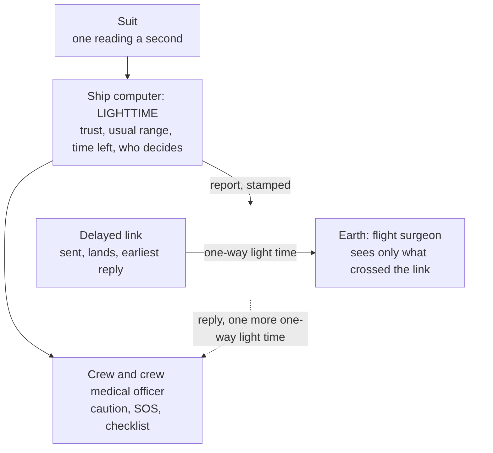
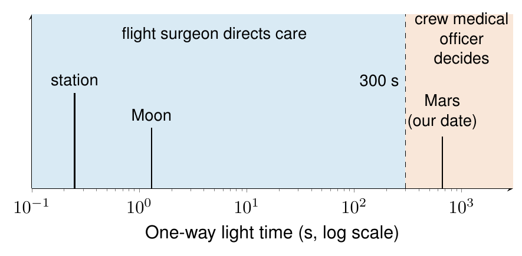
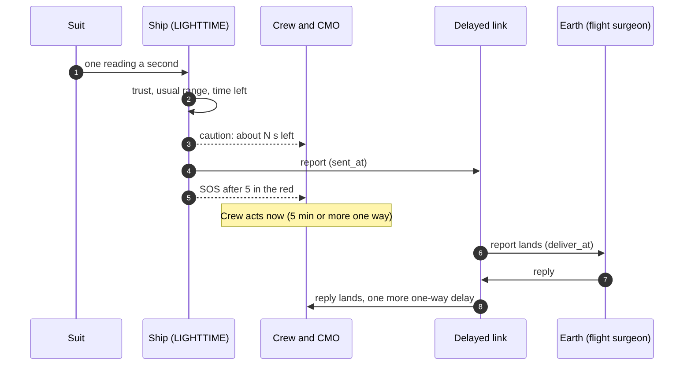
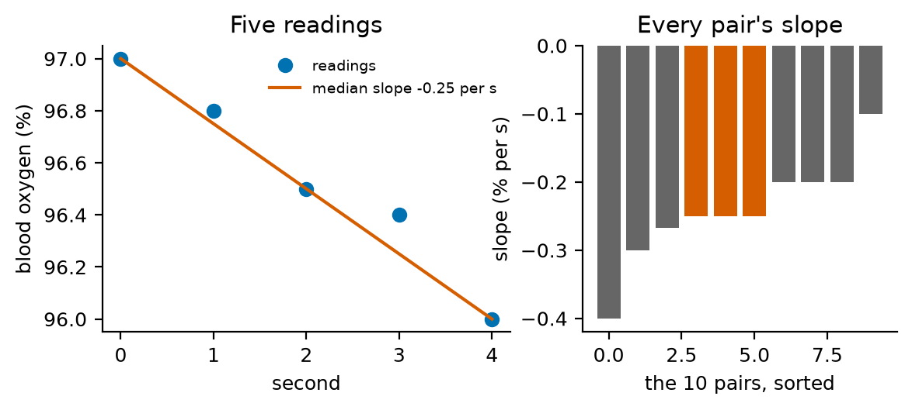
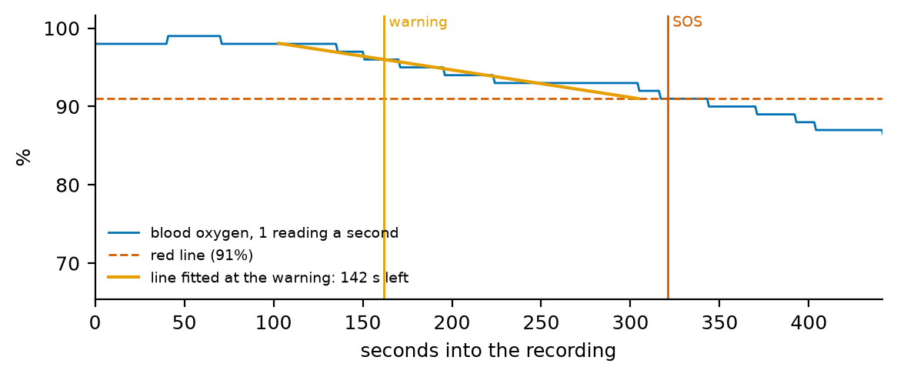
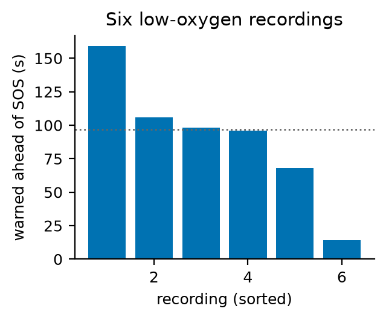
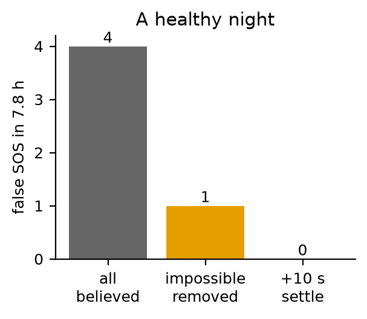
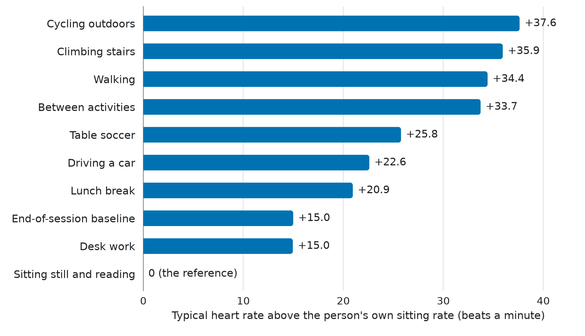

# LIGHT-TIME: the concept

What LIGHT-TIME is, why it exists, the words it uses and the math it does, with each number traced to the code. Written for a hackathon judge, a mentor or a new team member who knows high-school algebra and nothing about space medicine. Version of 15 November 2026.

There are three ways in: the two-minute summary below, the story of one emergency in section 4, and the math in section 5. The developers' word list is `CONTEXT.md`, and the technical documentation starts at [docs/tech/architecture.md](tech/architecture.md).

## 0. LIGHT-TIME in two minutes

A crew at Mars cannot call a doctor and get an answer in time. Radio travels at the speed of light, and on our mission date, 14 November 2026, light takes 660.86 s, about 11 minutes, to cross from Mars to Earth. An answer needs the message to arrive and the reply to come back, so the earliest reply from Earth is 1,321.72 s away, about 22 minutes. Health monitoring that pages a doctor on Earth is built for the space station, where the doctor answers at once.

LIGHT-TIME puts the light time into the decision. When a crew member's reading starts to fall, the ship's software, which we call LIGHTTIME, works out how long is left before the reading reaches a red line, compares that with the round trip to Earth, and says in one sentence who has to act: the flight surgeon on Earth, the crew medical officer (CMO) on board, or the crew alone when there is no link at all.

We built a crew console and an Earth console joined by a delayed link, a dial that moves the ship between the space station, the Moon, Mars and behind the Sun, and LIGHTTIME itself: fixed rules and a few statistics that one bad reading cannot throw off. No trained model decides anything, and no language model runs in the app. The crew's month of health data and the scripted emergency are simulated, and the screens say so.

The evidence is small. On six recorded falls in blood oxygen from healthy volunteers in a laboratory, the ship warned before the emergency level in 6 of 6, by a median of 97 s, and the result held when each recording was kept out of the tuning. On a 7.8-hour night of a person who was fine, the trust rules took false SOS alarms from 4 to 0. Nothing here has been tested on astronauts or validated clinically. Figure 1 shows how the parts fit.

Live console: <https://lighttime.health/>. Code: the ship and the link at <https://github.com/NASA-space-apps-the-procrastinators/LightTime-backend>, the consoles at <https://github.com/NASA-space-apps-the-procrastinators/LightTime-frontend>.

\
*Figure 1. The three layers. The suit sends one reading a second to the ship. LIGHTTIME judges it and tells the crew. A report crosses the delayed link to Earth, and any reply takes one more one-way light time to come back.*

## 1. The problem

The 2026 NASA Space Apps challenge we answered is "Create Health Monitoring Software for Astronauts on Space Missions". We read it as two questions. What should software watch on a crew member's body? And who should it tell, when the people who could help are far away?

On the International Space Station the second question is easy. A flight surgeon, a physician in mission control on Earth, is in contact with the crew in close to real time. On board, the crew medical officer is an astronaut given extra medical training before flight, who may or may not be a doctor (NASA-STD-3001 says crew medical officers often are, but need not be, physicians). A reviewer corrected us on this on 15 November. A space-medicine mentor told us on 14 November that health on the station is checked at scheduled times, daily or every few weeks depending on the mission, and is not streamed all day unless there is an emergency.

At Mars the easy answer fails. Mars and Earth both circle the Sun, so the distance between them keeps changing, and the one-way light time runs from about 3 to 22 minutes over the years: the closest and farthest distances in NASA's Mars fact sheet, divided by the speed of light [1]. Around solar conjunction, when the Sun sits between the planets, NASA stops sending commands to its Mars spacecraft for about two weeks, because gas thrown out by the Sun's corona can corrupt radio signals [2]. NASA's Human Research Program lists distance from Earth as one of the hazards of human spaceflight [3].

Think of lightning and thunder. The flash and the sound start together, and the gap between them grows with distance. Radio is the flash, and nothing is faster. From Mars even the flash takes minutes.

So a monitor that raises an alarm and waits for Earth is waiting for an answer that cannot arrive in time.

## 2. The idea

Who decides depends on how long the light takes. LIGHT-TIME uses one rule with three cases (`common/modes.py`):

| The link | One-way light time | Who acts | What Earth does |
|---|---|---|---|
| None (behind the Sun) | none | The crew, alone | Nothing yet. Everything is kept and sent, most urgent first, when the link returns |
| Up | 300 s or more | The crew medical officer, on the ship's checklist | Reviews afterwards |
| Up | under 300 s | The flight surgeon on Earth directs care | Directs. The ship drafts the report |

The switch at 300 s, five minutes, is our design choice. It follows a recommendation in Rader et al. (2013), who report NASA's NEEMO 16 analog mission: after a simulated medical emergency at a five-minute one-way delay, they concluded that more crew medical autonomy is desirable at delays of five minutes or more [4]. That is one simulation with one crew, so 300 s is a reasoned setting, not a measured threshold. It is one line in the code.

The wider idea, that a crew far from Earth needs medical care that leans less on Earth, is not ours. NASA calls it Earth Independent Medical Operations (EIMO), and its workshop report and papers describe care that becomes progressively less dependent on Earth as missions go further [5, 6]. What we add is small and concrete: software that recomputes who acts from the current light time and switches by itself, on every screen, the moment the distance changes.

Figure 2 shows the rule on one axis. The station is a phone call: you ask, you hear the answer, you act. Mars is a letter: by the time the reply comes you have already had to decide, so you write down what you did and why.

\
*Figure 2. Who decides, against one-way light time on a logarithmic axis. The station and the Moon sit well left of the 300 s line, where the flight surgeon directs care. Mars on our date sits right of it, where the crew medical officer decides. With no link at all, the crew acts alone.*

## 3. What we built, and what we did not

Everything in the right-hand column is a proposal, not something that runs.

| Built and running | Proposed, not built |
|---|---|
| The crew console: crew overview, a page per person with a body map, alert pages, the log | The suit itself: the Canadian Space Agency's Bio-Monitor smart shirt [7] with extra sensors added |
| The Earth console: what has crossed the link, and a reply box that says when the reply will land | Glove controls |
| The dial: space station, Moon, Mars, behind the Sun | A head-up display |
| The delayed link: each message queued, in flight or delivered | MQTT as the transport |
| LIGHTTIME: trust filters, alert bands, each person's usual range, time left, who decides, a report that answers Earth's first questions | FHIR packets for the medical record |
| The scripted story, and the console's click-through tour that ends with it | Five alert colours |
| The daily check-in, with a reaction-time test | An offline medical assistant for the CMO |
| Cabin and space-weather tiles | The learned heart-rate adviser wired into the alarms (it exists, offline) |
| Role-based views: each screen says who is looking | A sign-in |
| A reading endpoint that accepts the format a suit board would send ([docs/hardware.md](hardware.md)). The demo's suit readings are simulated | The suit electronics, as a design: an ESP32 DevKitC V4 reading a MAX30102 (heart rate and blood oxygen), a MAX30205 skin-temperature sensor, an MPU6050 motion sensor, two MyoWare 2.0 muscle sensors and a SPACEDOS02 radiation dosimeter, with a Bluetooth blood-pressure cuff at check-ins, sending readings to the ship over Wi-Fi |
| A routine vitals feed from the suits to Earth, with simulated values | |

**We assume the crew wear the shirt for the whole mission.** The reviewer of 15 November asked us to write this down, and everything that reads once a second rests on it. With the shirt off there are no readings, and the ship treats a poor or missing signal as a sensor check, never as a measurement.

## 4. One emergency, second by second

"Start story", in the console's header, opens a click-through tour. Its stops walk through the crew console, from the one-way light time in the header to an alert's round trip, and then Earth's side of the link. Some have a "Try it" action. The last offers "Watch it live", which asks the ship (`POST /api/base/demo/start`) to go back to the demo morning, turn the dial to Mars and play the full story from `base_station/scenario.py`. The story is scripted, plays the same way every time, and its readings are simulated.

The patient is the commander, C1. The crew medical officer is C2. Readings for C1, C2 and the flight engineer, C3, arrive once a second.

1. Calm. Everyone's readings sit in their normal range. LIGHTTIME judges each one and stays quiet.
2. Drift. The commander's blood oxygen begins to slide and the heart rate rises. The readings are still above 95 %, so no band has fired.
3. The time-left warning. About half a minute in, with the reading at 96 % and still in the normal band, LIGHTTIME finds a fall steady enough to trust. It works out about 70 seconds to the red line, compares that with Earth's earliest reply, and raises a caution. It speaks once: "[C1]. Blood oxygen 96 and falling. At this rate it reaches the red line in about 70 seconds. Earth's earliest reply is 22 minutes away. That is too late. Crew medical officer, check on [C1] now." (On screen, the commander's name stands where this document writes [C1].) A report leaves for Earth with that deadline frozen into it.
4. The SOS. Thirteen seconds later the reading has been at or below 91 % for five readings in a row. The alert becomes an SOS, and the SOS report leaves too. The stated 70 seconds was too long; section 6 explains why.
5. The crew acts. The CMO opens the alert: the sentence, the time left, the earliest reply, "Can Earth answer in time?", a short checklist, the reasons, and always the same last line, "This is a fixed rule, not a diagnosis. A person, not the ship, decides." When the crew ticks the treatment step, the script ends the fall and the reading recovers.
6. Earth hears. The report lands one one-way light time later: 660.86 s in mission time, played as 11.01 s on the demo clock. The flight surgeon sees a handoff in the SBAR form (situation, background, assessment, request) with the last 60 readings, the deadline as it stood when the report left, the commander's usual range, the checklist, and answers to six questions a flight surgeon asks first (`base_station/reports.py`). At Mars, each of those questions asked over the link would cost 22 minutes.
7. Earth's reply lands. The reply box says how long the reply will take. It travels one more one-way light time and appears in the alert's thread on the ship. If the link is down, it waits and leaves when the link returns. Figure 3 draws the same sequence.

\
*Figure 3. The alert round trip. The ship warns the crew and sends the report at once. At a one-way delay of five minutes or more, the crew acts before the report has even landed. The reply takes one more one-way delay.*

The walk-through is a three-way handshake: suit to ship, ship to crew, ship to Earth and back. Three kinds of traffic go to Earth. A report leaves the moment an early warning or an SOS is raised. A daily summary gives the low, median and high of each vital sign (`base_station/recorder.py`). And a routine vitals feed, started from the console (`POST /api/earth/feed/start`), sends one reading per crew member every 120 s by default, with any interval from 5 s to 3,600 s allowed, as one link message of kind `vitals` (`command_center/feed.py`). Feed messages take the same one-way light time as everything else, wait behind any SOS or report while the link is down, and carry values replayed from the simulated suit file, labelled SIMULATED. Earth keeps every tick it receives; the ship keeps its full stream, one reading a second, for 24 hours. This is store and forward, as with voicemail: keep it, and send it when you can.

## 5. The math, one piece at a time

Each piece has one plain sentence, the formula, a worked example with real numbers, and a line on what it is not. Every result is from `docs/generated/numbers.json` (written by `scripts/paper_numbers.py`) or from the printout of `scripts/paper_figures.py`. Every setting, such as a window length or a count of readings, was read from `base_station/lookahead.py`, `base_station/usual.py`, `base_station/limits.json`, `common/modes.py` or `common/link.py`, and the story's timings in section 4 come from playing `base_station/scenario.py` through the ship's rules.

### 5.1 Light time

Light needs time to cross a distance.

$$\Delta t = \frac{d}{c}$$

Here $d$ is the distance and $c$ the speed of light, 299,792.458 km/s, exact by the definition of the metre [8]. For 14 November 2026 NASA's JPL Horizons system [9] gives a one-way light time from Mars of $\Delta t$ = 660.86 s, so $d = c\,\Delta t \approx$ 198.1 million km. The ship asks Horizons live; if the call fails, it uses values read from Horizons beforehand and labels them with that date.

What it is not: a number the Deep Space Network measures. The network carries the signal. Our figure is the Horizons distance divided by the speed of light, and it leaves out time spent in relays or ground processing.

### 5.2 Round trip

An answer needs the message to arrive and the reply to come back.

$$T = 2\,\Delta t$$

At Mars on our date $T$ = 1,321.72 s, about 22 minutes. The Moon stop uses a fixed one-way time of 1.3 s, so $T$ is 2.6 s of light time alone. The station stop uses 0.25 s, so $T$ is 0.5 s.

What it is not: how long a reply really takes. Someone on Earth also has to read the report and decide, so a real reply is always later than $T$. A letter and its reply take the same time in the post both ways; the writing takes extra.

### 5.3 Who decides

One rule picks who acts.

$$
\text{who acts} =
\begin{cases}
\text{the crew, alone} & \text{if there is no link}\\
\text{the CMO; Earth advises after} & \text{if } \Delta t \ge 300\ \text{s}\\
\text{the flight surgeon on Earth} & \text{otherwise}
\end{cases}
$$

Station, 0.25 s: the flight surgeon directs care. Moon, 1.3 s: the same. Mars, 660.86 s: the CMO decides, because 660.86 is at least 300. Behind the Sun there is no link, so the crew acts alone and messages wait in a queue.

What it is not: a measured threshold. The 300 s line rests on one analog mission [4].

### 5.4 The demo clock

On stage, long legs play faster, and the true numbers stay on screen (`common/link.py`).

$$\text{played} = \begin{cases} \Delta t / 60 & \text{if } \Delta t \ge 60\ \text{s}\\ \Delta t & \text{otherwise}\end{cases}$$

The Mars leg plays in 660.86 / 60 = 11.01 s, and the header shows "plays as" beside the true one-way light time. Station and Moon legs play at their real length. Every message carries two kinds of stamp. Clock times (`sent_at`, `deliver_at`) are on the demo clock, which on the demo morning starts at 06:30 UTC on 14 November 2026. Durations (`delay_s`, the time left in flight `eta_s`, the earliest reply) are in true mission seconds; while a message is in flight, $\text{eta} = \Delta t \times (\text{lands} - \text{now}) / (\text{lands} - \text{sent})$.

What it is not: a different delay. The order of events and who decides are the same as at full length. Only the waiting is shorter.

### 5.5 Can a reading be trusted?

Three filters run before any number counts (`base_station/rules.py`, settings in `base_station/limits.json`).

$$\text{counted} = \big(50 \le x \le 100\big) \wedge \text{good signal} \wedge \text{10 clean readings since the last poor one}$$

A blood-oxygen value outside 50 to 100 % is a dropout, not a measurement. A reading the sensor flags as a poor signal is never judged; the ship shows "check your sensor" instead. And after any poor reading nothing can alarm for the next 10 readings, because a sensor just put back on reads low for a few seconds.

On a healthy night of 7.8 hours (Figure 7), believing every number gives 4 false SOS alarms. Throwing out impossible values leaves 1. Adding the settling rule leaves 0.

What it is not: a fix for a sensor that is wrong but plausible. A probe stuck on one sensible value passes all three filters.

### 5.6 How bad is it?

Each reading falls in a band, and a band counts only when it holds for five readings in a row.

| Blood oxygen | Level |
|---|---|
| above 95 % | none |
| 95 % or less | caution |
| 93 % or less | warning |
| 91 % or less | emergency: SOS, and the report leaves by itself |

$$\text{level}(t) = \text{the worst band that each of the last 5 clean readings has reached}$$

So the readings 92, 91, 91, 90, 91 give a warning, not an emergency: all five are at 93 or less, but the first is above 91. Five in a row means one bad reading can never raise an SOS on its own, like a smoke alarm that waits for a second whiff before it rings. The bands themselves are like the red zone on a rev counter: fixed marks, the same for everyone.

What it is not: a space-medicine score. The cut-offs are inspired by NEWS2, the early-warning chart of the Royal College of Physicians used in UK hospitals [10], which has not been tested in spaceflight. NEWS2 adds up scores for seven signs; LIGHT-TIME acts on one. These are demo tiers with a named source.

### 5.7 Is this normal for this person?

Each person has a usual range, learned from their own readings (`base_station/usual.py`).

$$\text{usual range} = \big[\,P_{1},\ P_{99}\,\big] \text{ of the person's clean readings over the last 24 hours}$$

A percentile is a place in a sorted list. Sort 100 readings from lowest to highest: the 1st percentile sits near the bottom, the 99th near the top, and almost every reading lies between them. The code takes the reading one hundredth of the way up the sorted list and the one one hundredth of the way down from the top. It leaves out typed numbers, poor signals and anything marked as exercise, and it says nothing until it has at least 600 readings, ten minutes at one a second. With exactly 600 it skips the six lowest and the six highest, so the range runs from the seventh lowest to the seventh highest. It is like knowing the usual hum of your own car: you judge it against itself, not against other cars.

The range is shown on the crew card and sent to Earth with every report, where it answers "Is this normal for this person?".

What it is not: an alarm. On real wrist recordings a personal range was too wide to alarm on, so it gives context only.

### 5.8 How long is left?

Draw the line the readings follow, and see where it meets the red line (`base_station/lookahead.py`).

LIGHTTIME takes the last 60 clean readings, one minute of data. For every pair of readings $i < j$ it works out the slope between them, and takes the median. This is the Theil-Sen line [11, 12]:

$$b = \operatorname{median}_{\,i<j}\ \frac{v_j - v_i}{j - i}$$

With $n$ readings there are $n(n-1)/2$ pairs. The level now is the median of the last five readings, and the time left to the red line of 91 % is

$$\text{time left} = \frac{\text{now} - 91}{-b}\quad\text{seconds, at one reading a second}$$

A worked example with five readings (Figure 4): 97.0, 96.8, 96.5, 96.4, 96.0. The 10 pairs give these slopes in % per second, sorted: −0.4, −0.3, −0.267, −0.25, −0.25, −0.25, −0.2, −0.2, −0.2, −0.1. The middle is −0.25 (with an even count the code takes the upper of the two middle values; here both are −0.25). The level now is 96.5, the median of the five. So

$$\text{time left} = \frac{96.5 - 91}{0.25} = 22.0\ \text{s}$$

The ship would still stay quiet on these five. It needs at least 15 readings before it calls anything a trend, and the fitted line must fall at least 2 points across the window; here it falls 1.0 point. It also stays quiet when the red line is more than 600 s away, and leaves slow drifts to the fixed bands.

The line uses a median, not the usual least-squares fit, because a few bad readings cannot drag a median off course. Up to a share of $1 - 1/\sqrt{2}$ of the readings, a little under a third, can be wildly wrong before the line fails [13], while one bad point can ruin a least-squares line. It is like judging when a bath will be empty from the water line: one splash cannot fool a median.

\
*Figure 4. The worked example: five readings and the line through the median slope (left), and all 10 pair slopes, with the median ones marked (right).*

What it is not: a forecast of the body. It assumes the fall carries on at the same rate, and a body can recover or fall faster.

### 5.9 Do the readings agree?

Most pairs must be falling, not just the ends.

$$\text{agreement} = \frac{\text{pairs that fall} - \text{pairs that rise}}{\text{all pairs}} \ \ge 0.5$$

In the worked example all 10 pairs fall, so the agreement is 1.0. At 0.5, falls outnumber rises by at least three to one among the pairs that moved. This is Kendall's rank correlation between time and the reading [14], with the sign turned round.

What it is not: a significance test. It is a gate that stops a noisy, flat signal from passing as a trend.

### 5.10 Can Earth answer first?

Compare the time left with the round trip.

$$\text{Earth can answer in time} \iff T < \text{time left}$$

A real recording (Figure 5): volunteer 100001 from a laboratory study of induced low oxygen [15]. The ship warned at 162 s with 142 s predicted to the red line, and the SOS came at 321 s, 159 s after the warning. At Mars $T$ = 1,321.72 s, far more than 142 s, so the crew must act and the sentence says so. At the Moon $T$ = 2.6 s, so Earth can answer first.

\
*Figure 5. One real low-oxygen recording, volunteer 100001: the reading once a second, the red line at 91 %, the line the ship fitted at the warning, and the SOS.*

What it is not: a promise that Earth's advice will be right or that the crew's action will work. It only says who can act before the red line.

## 6. What the evidence shows, and what it does not

The rules were played over three public sets of recordings before they were allowed to raise an alarm. Every number here is from `docs/generated/numbers.json`, and `scripts/check_spo2_rules.py` and `scripts/crossval_lookahead.py` reproduce them.

### The time-left rule warns before the emergency

Six healthy adults breathed lowered-oxygen gas in a clinical laboratory while a finger oximeter recorded once a second [15]. The ship warned before the emergency band in 6 of 6 recordings. Sorted, the warnings came 159, 106, 98, 96, 68 and 14 s ahead of the SOS, a median of 97 s (Figure 6). The shortest, 14 s, is too short to act on.

### The settings were chosen without the recording they were tested on

The time-left rule has three settings: the window, the smallest fall that counts, and the agreement. We tried a grid of 18 combinations, allowing only those that raised few trend warnings on the healthy night. Then, six times over, the best allowed combination was picked on five recordings and tested on the sixth. Held out this way, the ship still warned in 6 of 6, with a median of 97 s.

### The trust rules remove false alarms

Over 7.8 hours of blood oxygen from a person who was fine (Apnea-ECG record c01r [16]), false SOS alarms went from 4 with every number believed, to 1 with impossible values removed, to 0 with the settling rule (Figure 7). The time-left rule raised 2 cautions that night. A caution sends no SOS, but it is still a false warning, and we count it.

\
*Figure 6. Seconds of warning before the SOS for each of the six low-oxygen recordings, sorted, with the median dotted.*

\
*Figure 7. False SOS alarms on a healthy night as each trust rule is added.*

### Where the time-left rule stops helping

On a night of sleep apnoea from the same database, oxygen falls fast and often, and the trend warning came first in only a minority of the falls. When a fall is faster than one minute of readings can show, the fixed bands catch it.

### Why heart rate raises no alarm

On wrist recordings of healthy volunteers going about their day (PPG-DaLiA [17]), hospital heart-rate bands flagged nearly everyone at a desk, often in the first minutes of desk work after a walk. A fixed band cannot tell a heart that is settling from one in trouble, so heart rate is stored, shown beside the usual range and sent to Earth, and never raises an alarm by itself. One small statistical adviser was fitted offline from those recordings. It learns how far heart rate usually sits above a person's resting rate in each activity and flags a minute that strays more than 72.9 beats a minute from that. Tested on each held-out person in turn, the worst had 0.39 flagged minutes an hour. It is not wired into the app (`base_station/hr_normal.json`), because none of the recordings holds an emergency to test what it would catch.

\
*Figure 8. What the offline adviser learned: typical heart rate in each activity, above the person's own rate when sitting still and reading.*

### What this does not show

Six events is a small sample, all from one laboratory study on Earth, all induced low oxygen in healthy adults breathing a controlled gas. A fall in a spacecraft may look different. The settings and the test share the same six recordings and the same healthy night; holding each recording out answers part of that worry, not all of it. There is no astronaut data in this work, and no clinical validation.

Two limits come from the method. At the start of a fast fall the one-minute window still holds flat readings, so the fitted slope is too shallow and the stated time left too long: in the scripted story the ship says about 70 seconds and the SOS comes 13 seconds later. And the rules count readings at one a second, so a sensor that sends less often makes every alarm slower by the same factor. There is no rule yet for a fast heart rate at rest, a slow one in sleep, or a sensor stuck on one value. Nothing here is a medical device, and the checklist wording is not medical advice.

## 7. Privacy and safety by design

Our mentors raised privacy before we did. On the station today health is checked at scheduled times; LIGHT-TIME reads every crew member once a second, a far larger intrusion. A mentor framed it on 14 November as a question of proportionality: watching all the time has to earn its place against the intrusion, and the least intrusive option that still does the job should win. A Canadian Space Agency mentor added on 15 November that not every crew member should see everyone's vital signs: full records for the crew medical officer, each person's own record for everyone else, and an SOS that still reaches the whole crew.

The ship now does that, as role-based views (`base_station/access.py`, checked by `tests/test_access.py`). The console says who is looking in a header, `X-LightTime-Viewer`, or with `?viewer=` in the address. We ran the app and called it as each viewer to confirm this table.

| Who is looking | Their own record | Another person's record | Another person's alerts | Messages on the link |
|---|---|---|---|---|
| A crew member | In full | A name card only: id, name, role, suit, whether they are the CMO. Asking for more returns 403 | An SOS only, as a notice: who, which vital sign, the level, when, how far it has got. No value, reasons, checklist or time left. Quieter alerts are hidden | Their own, and messages about no one person |
| The crew medical officer, C2 | In full | In full | In full | All |
| The medical station (no viewer given) | In full | In full | In full | All |
| Earth | Not a crew member | Only what crossed the link: reports, daily summaries, feed ticks, crew messages | Through the reports | Everything delivered to Earth |

The packet log follows the same rule: a crew member sees only their own suit.

Three more protections are in the code. Earth's code cannot read the ship's tables: `command_center/` may read only the link's table, and `tests/test_wall.py` fails if any Earth file imports the ship's code or its crew, reading, alert, check-in or reminder tables. That is also what keeps the Earth console honest, since it cannot show anything Earth would not have yet. No language model is called while a request is handled, so no reading goes to an outside service, and the adviser keeps working behind the Sun. And impossible input is refused: an empty reading or an impossible heart rate is turned away, and blood oxygen outside the plausible range is treated as a dropout.

What is still missing. There is no login. The viewer header is believed, so anyone who can reach the ship can claim to be the CMO; nothing proves who is looking. A crewmate helping in an emergency cannot open the patient's record unless they are the CMO. And checking this section turned up a gap: a routine feed message carries every crew member's readings and is about no single person, so a crew member who opens the ship's outbox sees all of it. Last, the proportionality question is open. The raw stream stays on the ship, Earth gets reports, summaries and a low-rate feed whose interval can be raised, and crewmates see only their own record and an SOS notice. Whether that is proportionate is for crews and flight surgeons to judge, and it rests on the assumption in section 3 that the crew wear the shirt for the whole mission.

## 8. What is real and what is simulated

NASA and the Canadian Space Agency publish no open stream of astronaut vital signs, so every crew number in the app is simulated, and real data goes into everything around the crew.

| What | Source | Real or simulated | How it is marked |
|---|---|---|---|
| Mars light time | NASA JPL Horizons, asked live, with dated stored values as a fallback [9] | Real | The ship reports whether the figure is live or a dated fallback (`light_time_source`) |
| A second light-time figure | The round trip NASA's Deep Space Network reports for spacecraft at Mars [18] | Real | Beside the Horizons figure on the Earth console |
| Blood-oxygen bands | NEWS2 chart, Royal College of Physicians [10] | A published hospital chart | The alert's reasons name the source |
| Recordings used to test the rules | Induced low oxygen [15], a healthy and an apnoea night [16], wrist heart rate [17] | Real, from volunteers on Earth | Named in section 6; the `real` story replays one recorded fall |
| Cabin carbon dioxide, temperature, humidity | NASA Open Science Data Repository, Rodent Research 1 on the station [19] | A real NASA record, replayed | Marked as a NASA record on the tile |
| Cabin carbon dioxide limits | NASA technical brief OCHMO-TB-004 [20] | Real | Named with the console's daily rules (`GET /api/base/thresholds`) |
| The crew's month: daily values, baselines, the week | A seeded generator | Simulated | A Simulated tag in the console header |
| The story's readings | The story script (`scenario.py`) | Simulated | The same tag; the code marks the values SIMULATED |
| The routine vitals feed | The simulated suit file, replayed | Simulated | Every message carries `simulated: true` |
| Cabin oxygen, pressure, radiation dose, space weather | The generated month | Simulated | Marked as simulated on the tile |

## 9. What comes next

A real suit sensor on a real person, ideally a smart shirt like the Bio-Monitor, so the rules meet readings they were not tuned on. An emergency unlock, so the crewmate helping during an SOS can open the patient's record while the SOS lasts. A sign-in, so the viewer is proved and not just stated. Learned advisers, such as the heart-rate one, run beside the rules where they can only advise and never raise or silence an alarm. And a test in an analog habitat such as NASA's Human Exploration Research Analog (HERA), whose crews already work with communication delays of up to five minutes each way [21].

## 10. Glossary

"Built" means it runs in the code today; "proposed" means it does not.

| Term | Plain meaning | Think of it like | In LIGHT-TIME |
|---|---|---|---|
| Agreement (of a trend) | Share of reading pairs that fall, minus the share that rise | A show of hands | 0.5 or more before a time-left warning. Built (5.9) |
| Alert level | How serious an alert is: caution, warning, emergency | Traffic lights | From the bands and the time-left rule. Built |
| Analog mission | A mission on Earth that imitates spaceflight | A fire drill | NEEMO 16 set our 300 s choice; HERA is a proposed test bed [4, 21] |
| Band | A fixed range of readings with one level | The red zone on a rev counter | Blood oxygen at 95, 93, 91 %. Built (5.6) |
| Baseline and usual range | A person's own normal: a daily band set before flight, and a range learned from the last 24 hours | Your car's usual hum | Crew card and reports. Built (5.7) |
| Caution | The lowest alert level | A yellow light | 95 % or less for five readings, or a steady fall. Built |
| Conjunction (solar) | The Sun between Earth and Mars, disrupting radio | A wall across the road | The "behind the Sun" stop: no link. Built |
| Crew medical officer (CMO) | The astronaut in charge of medical care on board, with extra medical training before flight, not always a doctor | The first-aider | C2. Leads at 300 s or more. Built |
| Delayed link | The channel between ship and Earth; nothing lands before its light time | The post | Queued, in flight, delivered. Built |
| Demo clock and mission seconds | Clock times on the sped-up demo clock; durations in true seconds | A replay with real times printed on it | Long legs play 60 times faster. Built (5.4) |
| Deep Space Network | NASA's antennas that carry signals to spacecraft | The phone line, not the clock | Its round trip is shown as a check. Built |
| Dial | The control that sets where the ship is | A map pin | Station, Moon, Mars, behind the Sun. Built |
| Dropout | A value the sensor cannot really give | A crackle on the line | Ignored; the settle rule starts. Built (5.5) |
| Earliest reply | The soonest an answer can arrive: the round trip | Return post | On every alert. Built |
| Earth Independent Medical Operations (EIMO) | NASA's name for care that leans less on Earth as missions go further | A ship's doctor on a long voyage | The idea behind who decides [5, 6] |
| Emergency and SOS | The highest level; an SOS reaches the whole crew and sends a report | A fire alarm | 91 % or less for five readings, or the SOS button. Built |
| Flight surgeon | A physician on Earth, in mission control | The family doctor on the phone | Directs care under 300 s. Built |
| JPL Horizons | NASA's service for where planets and spacecraft are | An almanac | Source of the Mars light time. Built |
| Kendall's tau | How often pairs move the same way | A show of hands | Agreement is its negative. Built |
| LIGHTTIME | The ship's software that judges readings: rules and statistics, no trained model | A checklist that can count | Every reading. Built |
| Light time (one-way) | How long a signal takes from ship to Earth | Lightning before thunder | 660.86 s at Mars on our date. Built (5.1) |
| Median | The middle of a sorted list | The middle person in a height line | Slope and current level. Built |
| Medical station | The ship's screen when no viewer is given | The sick bay's terminal | Sees every record. Built |
| NEWS2 | A UK hospital early-warning chart | A hospital's traffic lights | Source of the cut-offs; not tested in spaceflight [10] |
| Percentile | A place in a sorted list, as a share of the way up | A rank in a race | 1st and 99th give the usual range. Built |
| Plausible range | Values a sensor can really give | A thermometer that cannot read 200 | Blood oxygen 50 to 100 %. Built |
| Playback speed | How much faster the demo plays a long leg | Fast-forward | 60 times, legs of 60 s or more. Built |
| Red line | The value at which a reading is an emergency | An empty tank | 91 % blood oxygen. Built |
| Report | What the ship sends Earth about an alert | A handover note | On an early warning or SOS. Built |
| Role-based view | A screen shaped by who it says is looking; not a login | A name badge, not a key | Viewer header. Built (7) |
| Round trip | Twice the one-way light time | A letter and its reply | 1,321.72 s at Mars on our date. Built (5.2) |
| SBAR report | Situation, background, assessment, request | A shift handover | Every report. Built |
| Sensor check | A poor-signal reading, never judged; state `RECHECK` | A check-engine light | "Check your sensor". Built |
| Settle | Readings ignored after a poor signal | Letting a scale settle | 10 readings. Built (5.5) |
| Simulated | Made by a script, not measured | A flight simulator | Crew month, story, feed. Labelled |
| Smart shirt (CSA Bio-Monitor) | A shirt with sensors that records vital signs [7] | A fitness watch you wear | Assumed worn all mission. Proposed |
| Space weather | Activity on the Sun, such as particle storms | Weather, from the Sun | Tile with a simulated advisory. Built |
| SpO2 (blood oxygen) | How much of the blood's oxygen-carrying capacity is in use, in % | How full the delivery trucks are | Watched by the time-left rule. Built |
| Store and forward | Keep data and send it when the link allows | Voicemail | Reports, summaries, feed. Built |
| Sustain | A band counts only after several readings in a row | A smoke alarm that waits for a second whiff | 5 readings. Built (5.6) |
| Telemetry | Measurements sent from a distance | A dashboard read from home | The vitals feed to Earth, simulated. Built |
| Theil-Sen line | A line whose slope is the median of all pair slopes | Asking every pair and taking the middle answer | Time left. Built (5.8) |
| Time left | Seconds until a falling reading reaches the red line | When the bath will be empty | Every trend warning. Built (5.8) |
| Triage | Deciding who acts, and how urgently | Sorting patients at the door | Who decides, and alert levels. Built |
| Viewer header | The line the console sends to say who is looking | A name badge | `X-LightTime-Viewer`. Built |
| Warning | The middle alert level | An amber light | 93 % or less for five readings. Built |
| Who decides | The rule that picks who acts from the light time | Phone call or letter | Flight surgeon, CMO, or crew alone. Built (5.3) |

## 11. References

Entries 2, 7 and 21 are new in this document and were opened at their publisher on 15 November 2026. Every other entry is copied from `docs/how-it-works.md` or `docs/submission.md`, where each was opened at its publisher, NASA, PhysioNet, UCI or a DOI record on 15 November 2026.

1. NASA Space Science Data Coordinated Archive (2025). Mars Fact Sheet. <https://nssdc.gsfc.nasa.gov/planetary/factsheet/marsfact.html>
2. NASA (2023). NASA's Mars Fleet Will Still Conduct Science While Lying Low. 10 November 2023. <https://www.nasa.gov/solar-system/planets/mars/nasas-mars-fleet-will-still-conduct-science-while-lying-low>
3. NASA Human Research Program. Hazard: Distance From Earth. <https://www.nasa.gov/hrp/hazard-distance-from-earth/> (modified 1 August 2024).
4. Rader SN, Reagan ML, Janoiko B, Johnson JE (2013). Human-in-the-Loop Operations over Time Delay: NASA Analog Missions Lessons Learned. 43rd International Conference on Environmental Systems, Vail, Colorado. AIAA 2013-3520. <https://doi.org/10.2514/6.2013-3520>. Full text: <https://ntrs.nasa.gov/citations/20130011552>
5. Lemery J, MacNeill K, Fleming N, Easter B, Marchica A, Berens KL, Lehnhardt K (2024). Earth Independent Medical Operations (EIMO) Definition Workshop. NASA/TM-20240002454. <https://ntrs.nasa.gov/citations/20240002454>
6. Levin DR, Steller J, Anderson A, Lemery J, Easter B, Hilmers DC, Lehnhardt KR (2023). Enabling Human Space Exploration Missions Through Progressively Earth Independent Medical Operations (EIMO). IEEE Open Journal of Engineering in Medicine and Biology 4: 162-167. <https://doi.org/10.1109/OJEMB.2023.3255513>
7. Canadian Space Agency. Bio-Monitor: Keeping an eye on astronauts' vital signs. <https://www.asc-csa.gc.ca/eng/sciences/bio-monitor.asp> (modified 26 February 2026).
8. Bureau International des Poids et Mesures. SI defining constants. <https://www.bipm.org/en/measurement-units/si-defining-constants> (read 15 November 2026).
9. Giorgini JD and JPL Solar System Dynamics Group. NASA/JPL Horizons On-Line Ephemeris System. <https://ssd.jpl.nasa.gov/horizons/> (data retrieved 15 November 2026).
10. Royal College of Physicians (2017). National Early Warning Score (NEWS) 2: Standardising the assessment of acute-illness severity in the NHS. Updated report of a working party. London: RCP. <https://www.rcp.ac.uk/improving-care/resources/national-early-warning-score-news-2/>
11. Theil H (1950). A rank-invariant method of linear and polynomial regression analysis, I, II and III. Proceedings of the Koninklijke Nederlandse Akademie van Wetenschappen 53: 386-392, 521-525, 1397-1412.
12. Sen PK (1968). Estimates of the regression coefficient based on Kendall's tau. Journal of the American Statistical Association 63(324): 1379-1389. <https://doi.org/10.1080/01621459.1968.10480934>
13. Rousseeuw PJ, Leroy AM (1987, reprinted 2003). Robust Regression and Outlier Detection. New York: Wiley. Pages 67 and 164 give the breakdown point of the median-of-slopes line.
14. Kendall MG (1938). A new measure of rank correlation. Biometrika 30(1-2): 81-93. <https://doi.org/10.1093/biomet/30.1-2.81>
15. Hoffman JS, Viswanath VK, Tian C, Ding X, Thompson MJ, Larson EC, Patel SN, Wang EJ (2022). Smartphone camera oximetry in an induced hypoxemia study. npj Digital Medicine 5(1): 146. <https://doi.org/10.1038/s41746-022-00665-y>. Data: <https://github.com/ubicomplab/oximetry-phone-cam-data> (MIT licence).
16. Penzel T, Moody GB, Mark RG, Goldberger AL, Peter JH (2000). The Apnea-ECG Database. Computers in Cardiology 27: 255-258. <https://doi.org/10.1109/CIC.2000.898505>. Data: Apnea-ECG Database v1.0.0, PhysioNet, <https://doi.org/10.13026/C23W2R> (Open Data Commons Attribution License v1.0).
17. Reiss A, Indlekofer I, Schmidt P, Van Laerhoven K (2019). Deep PPG: Large-Scale Heart Rate Estimation with Convolutional Neural Networks. Sensors 19(14): 3079. <https://doi.org/10.3390/s19143079>. Data: PPG-DaLiA, UCI Machine Learning Repository, <https://doi.org/10.24432/C53890> (CC BY 4.0).
18. NASA Jet Propulsion Laboratory. Deep Space Network Now. <https://eyes.nasa.gov/apps/dsn-now/> (data feed <https://eyes.nasa.gov/dsn/data/dsn.xml>, read 15 November 2026).
19. NASA Open Science Data Repository. Environmental Data App (EDA), mission RR-1 (Rodent Research 1). <https://visualization.osdr.nasa.gov/eda/> (read 15 November 2026).
20. NASA Office of the Chief Health and Medical Officer. Carbon Dioxide (CO2). OCHMO-TB-004, Revision D. <https://www.nasa.gov/wp-content/uploads/2023/12/ochmo-tb-004-carbon-dioxide.pdf>
21. NASA (2022). Houston, Do You Copy? HERA Crew Navigates Communication Delays. 19 October 2022. <https://www.nasa.gov/humans-in-space/houston-do-you-copy-hera-crew-navigates-communication-delays>
