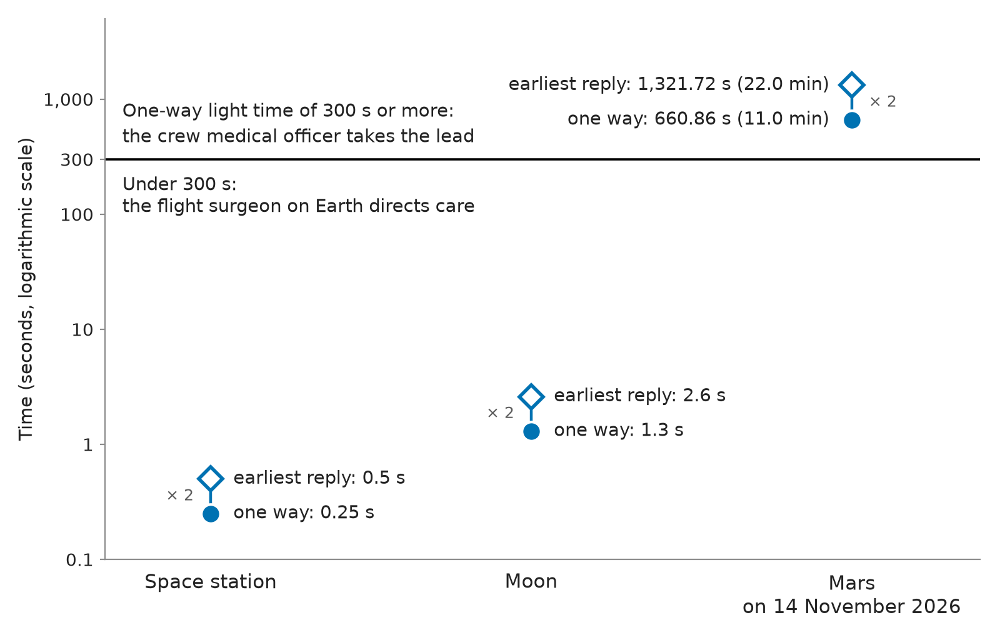
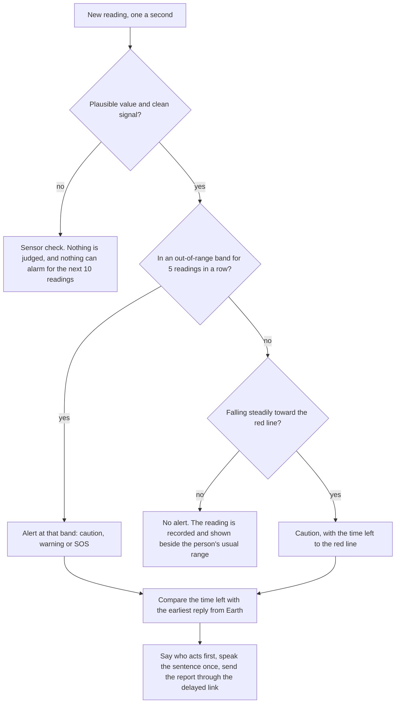
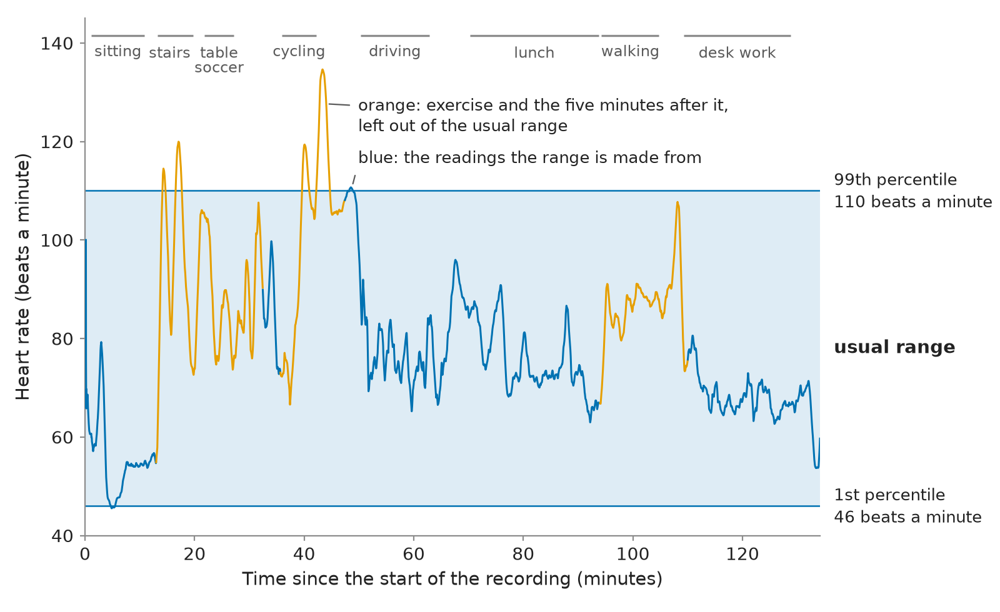
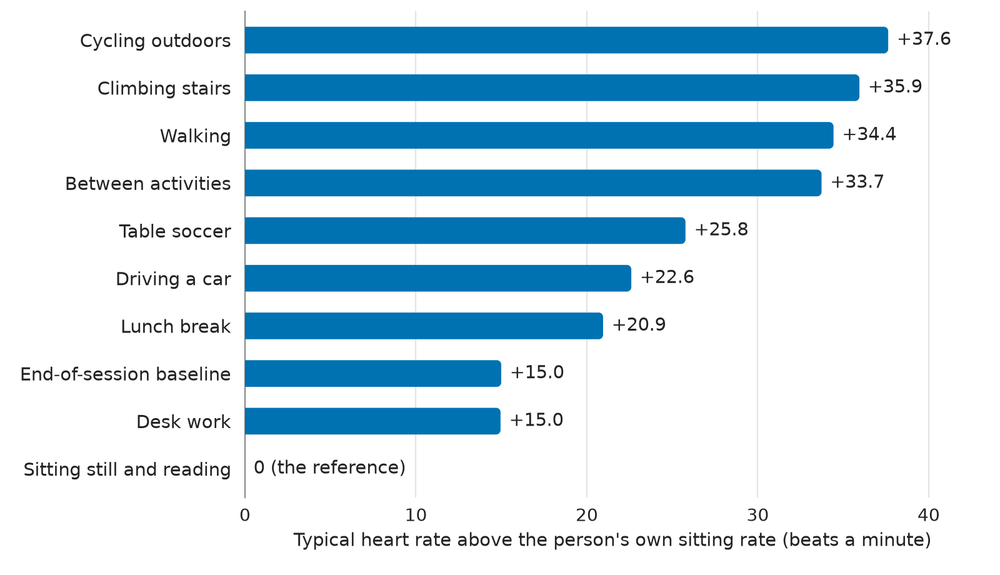
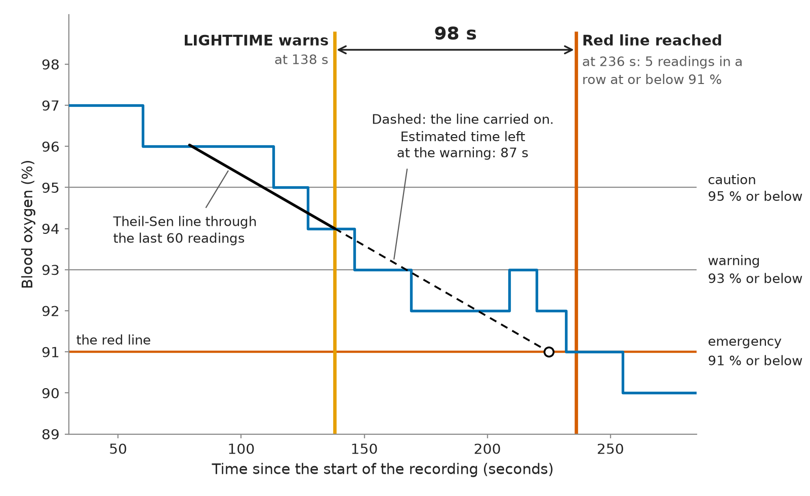
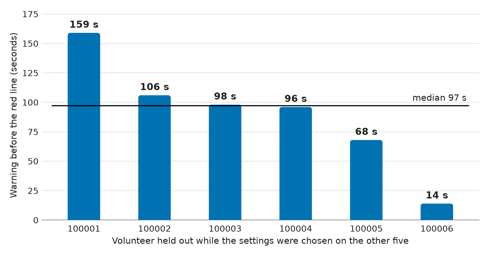
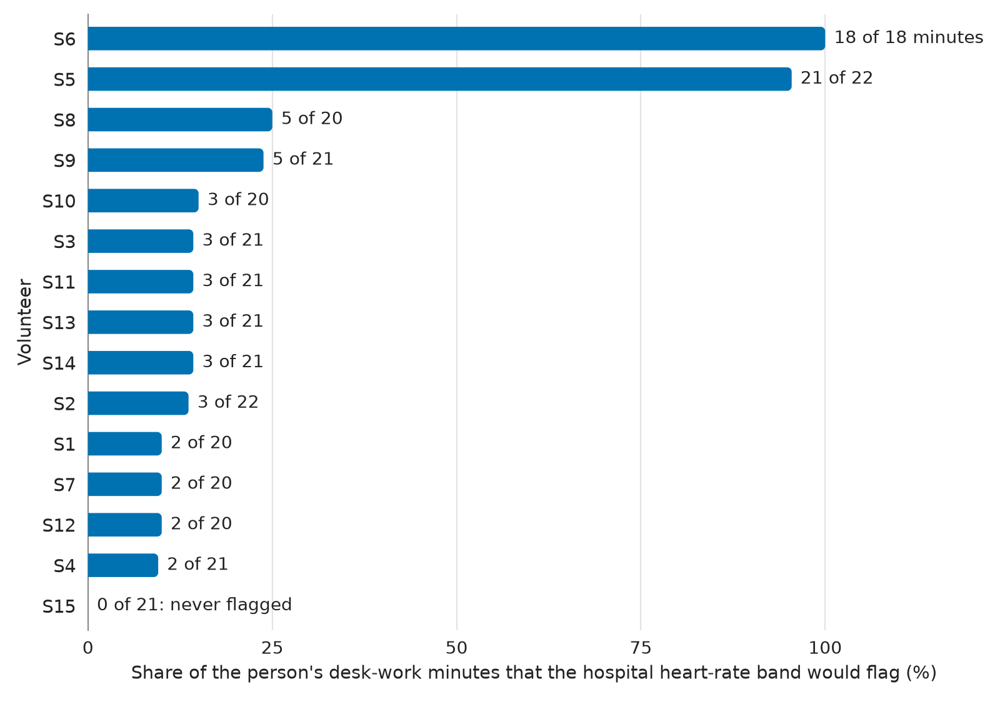

# How LIGHT-TIME works: the math, the statistics and the evidence

This document explains what the software computes and why, what was tested and what was not. Every number in it comes from the code in this repository or from a script that can be run again; the file or command is named beside it. It is written for a judge, a reviewer or a new team member who wants to check the work, not take it on trust.

The short version: LIGHT-TIME makes no diagnosis and uses no trained model to decide anything. It uses the speed of light, fixed rules taken from a published clinical chart, and a small set of robust statistics, each one tested on real recordings before it was allowed to raise an alarm.

## 1. The idea

A crew member's blood oxygen starts to fall. Two clocks start with it.

The first clock is the body's: how long until the reading reaches a level where a person must act. The second is the link's: how long until the earliest possible answer from a flight surgeon on Earth, which is twice the one-way light time, because the report has to travel there and the answer has to travel back.

LIGHT-TIME compares the two. If the answer can arrive first, the flight surgeon directs care and the ship drafts the report. If it cannot, the ship says so in one plain sentence and the crew medical officer acts on the on-board checklist, while the report travels to Earth for review. If there is no link at all, the crew is alone and everything is kept for when the link returns.

    time_left  = (reading now - red line) / rate of fall
    reply_time = 2 x one-way light time
    Earth can answer in time only if reply_time < time_left

On the demo morning at Mars the sentence the ship speaks is: "TJ. Blood oxygen 96 and falling. At this rate it reaches the red line in about 70 seconds. Earth's earliest reply is 22 minutes away. That is too late. Crew medical officer, check on TJ now."

### What is different about it

Health monitors raise alarms. This one also states a deadline and says who can meet it. Five design choices follow from that.

| Choice | What it means in the app |
|---|---|
| The distance is a control | One dial has four stops: space station, Moon, Mars, behind the Sun. Moving it changes the delay, who decides, what the ship says and how the link behaves, on every screen |
| A deadline, not only an alarm | Each falling-trend warning carries the time left to the red line and whether Earth can answer first |
| The report arrives already answered | A question to Earth costs a round trip, so the report carries the answers to the questions a flight surgeon asks first |
| Two consoles that are honestly out of date | The Earth console shows only what the link has delivered. A reply takes the same road back |
| Real numbers where they exist, labels where they do not | Mars light time comes from NASA JPL Horizons and is checked against the figure NASA's Deep Space Network reports. Cabin carbon dioxide is a NASA record. Crew vital signs are simulated, and the screen says so |

## 2. Light time

### The formula

A radio signal travels at the speed of light, so the one-way delay is the path length divided by c.

    D = d / c        c = 299,792.458 km/s (exact, by definition of the metre)

The dial's four stops (`common/modes.py`, `common/lighttime.py`):

| Stop | One-way delay D | Path that delay stands for | Earliest reply 2D | Who decides |
|---|---|---|---|---|
| Space station | 0.25 s (fixed) | 74,948 km | 0.5 s | Flight surgeon on Earth |
| Moon | 1.3 s (fixed) | 389,730 km | 2.6 s | Flight surgeon on Earth |
| Mars, 14 November 2026 | 660.86 s (NASA JPL Horizons) | 198,120,844 km, or 1.32 astronomical units | 1,321.72 s, about 22 minutes | Crew medical officer |
| Behind the Sun | no link | | none | The crew, alone |

### Where the Mars number comes from

The ship asks NASA's JPL Horizons system for Mars (body 499) as seen from the centre of the Earth (`500@399`), observer table, quantity 21, which is the one-way light time in minutes. The code multiplies by 60. If the call fails, the ship uses values read from Horizons on 13 November 2026 and labels them with that date: 660.86 s for 14 November, 656.62 s for 15 November, 652.36 s for 16 November. Mars is moving closer to Earth this week, so the delay shrinks by about four seconds a day.

A second NASA system checks the first. The Deep Space Network's public feed reports the round-trip light time (`rtlt`) to each spacecraft its antennas are tracking. The Earth console halves the median of the Mars spacecraft values and shows it beside the Horizons figure (`common/dsn.py`, `GET /api/earth/network`). On 15 November the two were 1.6 s apart: 656.62 s computed by Horizons and 655 s from the network, which reported a round trip of 1,310 s to Mars Odyssey. They are not expected to match exactly. Horizons gives the time from the centre of Mars to the centre of the Earth, the network's figure is for an antenna on the ground and a spacecraft at Mars, and the feed carries three significant figures.

### Who decides

    no link               ->  the crew, alone
    D >= 300 s            ->  crew medical officer leads, Earth reviews afterwards
    D <  300 s            ->  flight surgeon on Earth directs care

The 300 s switch point is the project's own design choice. It rests on NASA's NEEMO 16 analog mission, which ran a simulated medical emergency at a five-minute delay and concluded that more crew medical autonomy is desirable at delays of five minutes or more (Rader et al., 2013). That paper reports one simulation with one crew and names finding the real threshold as future work, so 300 s is a reasoned setting and not a measured one. It is one line in `common/modes.py`.

### The link

Every message between ship and Earth is a row with three times: when it was sent, the delay, and when it lands. The other side cannot see it until the landing time has passed (`common/link.py`). The Earth API reads that table and the dial's position, and nothing else: `command_center/` never imports the ship's crew, reading, alert, check-in or reminder tables. That wall is what makes the Earth console honest. It cannot show anything Earth would not have yet.

When there is no link, messages wait in a queue. When the link returns they leave in order of urgency: a report is priority 0, an escalation to an emergency 0, other updates 1, crew messages 2, daily summaries 3.

For a demo nobody can wait eleven minutes, so a leg of 60 s or more plays 60 times faster: the Mars leg of 660.86 s plays in 11.0 s. The true figure is never hidden. The time left on a message in flight is reported in mission seconds:

    played seconds   = D / 60        if D >= 60 s, else D
    mission eta      = D x (lands_at - now) / (lands_at - sent_at)

## 3. LIGHTTIME: three questions, in order

LIGHTTIME is the ship's adviser. For each reading, one a second for each person, it asks three questions.

### Question 1. Can this reading be trusted?

Most false alarms on a monitor come from the sensor, not the patient. So before any rule looks at a number, four checks run (`base_station/rules.py`, settings in `base_station/limits.json`).

A blood-oxygen value outside 50 to 100 % is treated as a dropout, not a measurement. A reading flagged with a poor signal is never judged; the ship raises a "check your sensor" notice instead. After any poor reading, nothing can alarm for the next 10 readings, because a sensor that has just been put back on reads low for a few seconds. And a band counts only when the last 5 readings from the same sensor are all in that band or worse, each with a clean signal:

    level(t) = the worst band s such that band(x) >= s for each of the last 5 clean readings

The bands are those of the NEWS2 chart (Royal College of Physicians, 2017), the early-warning score used in UK hospitals. The level names are the project's own, and where NEWS2 adds the scores of seven signs before deciding a response, LIGHT-TIME acts on the single sign:

| Blood oxygen | NEWS2 score | LIGHT-TIME level |
|---|---|---|
| 96 % and above | 0 | none |
| 94 to 95 % | 1 | caution |
| 92 to 93 % | 2 | warning |
| 91 % and below | 3 | emergency: SOS, and the report leaves by itself |

Three more rules keep the alarm honest. A number typed by a person is judged at once but can never go above a warning, because a typo should not be able to send an SOS. After a person clears an alert, the same alert stays quiet for 60 s unless it gets worse, as the alarm pause on a bedside monitor does. And two readings are stored but never raise an alarm on their own: heart rate, and the suit's estimate of blood pressure. Section 5 gives the evidence for both.

### Question 2. Is this normal for this person?

A resting heart rate of 52 is ordinary for one person and a warning sign for another. LIGHT-TIME holds two kinds of personal reference.

The first is the usual range, learned on board (`base_station/usual.py`). It is the 1st and 99th percentile of the person's own clean sensor readings over the last 24 hours, leaving out readings marked as exercise, and it needs at least 600 readings, ten minutes of data, before it says anything:

    usual range = from the value one hundredth of the way up the sorted readings
                  to the value one hundredth of the way down from the top
                  (n >= 600 readings, last 24 h, exercise left out)

It is shown on the crew card and sent to Earth with every report, where it answers the question "Is the heart rate normal for this person?". It does not raise alarms, because on real wrist recordings a personal range turned out too wide to be useful as an alarm.

The second is the daily baseline, the kind a flight surgeon uses (`base_station/scoring.py`, wording in `data/reference/console_thresholds.json`). The trigger values of these daily rules are the project's own design choices. The NASA documents named beside them on screen are background reading, and several of the values are not in them (see the review, section 8). Each crew member has their own band for resting heart rate, blood pressure, blood oxygen, temperature, breathing rate and sleep, set before flight. Each morning value is scored against it:

| State | Rule |
|---|---|
| OK | inside the person's own band |
| WATCH | outside the band once. Silent, in the daily summary |
| ALERT | outside the band three days running, or with a symptom, or past a hard limit: blood oxygen under 94 %, temperature over 38.0 °C, radiation dose over 2 mSv in a day |

On the demo morning the commander's resting heart rate reads 60, 59, 58, 59, 80, 82, 84 across the week against a personal band of 52 to 64. The third day outside the band raises alert A1.

### Question 3. How long is left, and can Earth answer first?

A fixed band only fires once the number is already bad. The third question looks ahead (`base_station/lookahead.py`).

Take the last 60 clean readings, one minute of data. For every pair of readings compute the slope between them, 1,770 slopes for 60 readings, and take the median. This is the Theil-Sen estimator (Theil, 1950; Sen, 1968):

    slope b = median over all pairs i < j of (x_j - x_i) / (j - i)

A median of pairwise slopes is used in place of a least-squares line because a few bad readings cannot pull it off course. Its breakdown point is 1 - 1/sqrt(2), about 29 %: up to that share of the readings can be arbitrarily wrong before the estimate fails (Rousseeuw and Leroy, 1987). A least-squares line can be ruined by a single bad point. It also assumes nothing about how the noise is distributed.

A slope alone is not enough, since noise always has some slope. Four conditions must all hold before the ship speaks:

| Condition | Setting | Why |
|---|---|---|
| Enough data | at least 15 readings | fewer is not a trend |
| The fall is consistent | agreement of at least 0.5 | see below |
| The fall is real | the fitted line drops at least 2 points across the window | ignores drift inside the sensor's resolution |
| The deadline is near | the red line is at most 600 s away | a slow drift is left to the fixed bands, which catch it |

Agreement is the share of reading pairs that fall minus the share that rise:

    agreement = (pairs that fall - pairs that rise) / all pairs

This is Kendall's rank correlation between time and the reading (Kendall, 1938) with the sign reversed, the same statistic the Mann-Kendall trend test is built on. A value of 1 means every later reading is lower than every earlier one. Requiring 0.5 means the falls outnumber the rises by at least three to one among the pairs that moved.

If all four hold, the time left is the distance to the red line divided by the rate of fall, with the current level taken as the median of the last 5 readings:

    time_left = (median of last 5 - 91) / (-b)        seconds, at one reading a second

Then the comparison from section 1 is made and frozen into the report, so that Earth later sees exactly what the ship knew when it spoke.

A worked example, measured on the running app with the dial on Mars: the level was 96.0 %, the slope -4.3 points a minute, the agreement 0.65.

    time_left  = (96.0 - 91) / (4.3 / 60) = 70 s
    reply_time = 2 x 660.86 = 1,321.72 s
    1,321.72 < 70 is false, so Earth cannot answer in time

The ship raised a caution while the reading was still 95.5 %, inside the normal band, and spoke the sentence in section 1.

### What the crew and Earth receive

The crew sees a card with the sentence, the time left, the earliest reply, the answer to "Can Earth answer in time?", a short checklist to tick, and the reasons, under the line "Why the ship says this". The reasons list what was seen, the last readings, the rule, the source of the band table, and always the same closing line: "This is a fixed rule, not a diagnosis. A person, not the ship, decides."

Earth receives a handoff report in the SBAR form that clinicians use (situation, background, assessment, request), the last 60 readings, the frozen deadline, the person's usual range and the checklist. It also receives the answers to six questions a flight surgeon would ask first, written before the report leaves (`base_station/reports.py`): how the reading moved over the last minute, how long until it is critical, whether the heart rate is normal for this person, whether the sensor is reading cleanly, what the crew has done so far, and how the person slept and felt at the last check-in. At Mars each of those questions would otherwise cost 22 minutes.

The raw stream never leaves the ship. A recorder keeps 24 hours of readings (`base_station/recorder.py`); what goes to Earth is a report when something happens and a daily summary of the low, median and high of each vital sign.

## 4. What was learned from data, and why no trained model decides

The plain answer to "which machine-learning model does it use?" is: none makes, changes, silences or ranks an alert. That is a recorded decision (`docs/adr/0001-rules-decide-learned-models-advise.md`), made for four reasons.

There is nothing to train on. NASA and the Canadian Space Agency publish no open stream of astronaut vital signs, and the real recordings available hold six induced falls in blood oxygen and no medical emergencies. A model fitted to that would be untestable.

Every alert must be checkable by the person acting on it. A rule can print its reasons in four lines. A fitted model cannot.

The software must behave the same way every time. The rules are deterministic and covered by 192 automated tests.

It must work with no link. No language model or outside service is called while handling a request, so the adviser keeps working behind the Sun.

Data was still used, in the way a careful machine-learning project would use it, in three places.

**Rules were tested on real recordings before they were allowed to alarm.** Section 5 has the results. Two rules were switched off because the data showed they would cry wolf.

**The settings of the time-left rule were chosen by cross-validation.** Eighteen combinations of window (45 or 60 readings), minimum fall (1.5, 2.0 or 2.5 points) and agreement (0.4, 0.5 or 0.6) were tried. A combination was allowed only if it gave at most 3 trend warnings across a 7.8-hour recording of a healthy sleeper. Then, six times, the best allowed combination was chosen on five volunteers (most volunteers warned first, then the longest median warning) and tested on the sixth, who had played no part in the choice (`scripts/crossval_lookahead.py`). All six rounds chose the same settings: window 60, fall 2.0, agreement 0.5.

**One small statistical model was fitted offline, and it is not connected to the app.** It learns how far heart rate normally sits above a person's own resting rate in each activity, from the wrist recordings of 15 people (`scripts/learn_hr_normal.py`):

    expected heart rate = person's resting median + effect[activity]
    effect[activity]    = median over people of (median rate in that activity - resting median)
    limit               = 99.9th percentile of |rate - expected| over the training people
    flag a minute       = 60 seconds in a row further than the limit from expected

It was fitted fifteen times, each time leaving one person out and testing on that person. The gate set before running it was at most one flagged minute an hour on any held-out healthy person. It passed: the worst person had 0.39 flagged minutes an hour and the other fourteen had none. The fitted limit is about 73 beats a minute from expected, and the learned effects range from 15 beats above resting for desk work to 38 for cycling (`base_station/hr_normal.json`). Two cautions apply. None of the recordings contains an emergency, so the model can say "unusual for this activity" and never "dangerous", and how often it would catch a real problem is unknown. And a limit that wide will miss moderate changes. It is an adviser kept on the bench, with its gate recorded, until there is data to test what it catches.

## 5. The evidence

Every figure below was reproduced on 15 November 2026 by running the named script on a clean copy of this repository.

### The time-left rule warns before the emergency

Six healthy adults breathed lowered-oxygen gas in a clinical laboratory while a finger oximeter recorded once a second (Hoffman et al., 2022). Their recordings were played through the ship's rules.

| Volunteer | Ship warned at | Emergency band reached at | Warning ahead by | Time left the ship stated |
|---|---|---|---|---|
| 100001 | 162 s | 321 s | 159 s | 142 s |
| 100002 | 235 s | 341 s | 106 s | 56 s |
| 100003 | 138 s | 236 s | 98 s | 87 s |
| 100004 | 221 s | 317 s | 96 s | 58 s |
| 100005 | 112 s | 180 s | 68 s | 84 s |
| 100006 | 114 s | 128 s | 14 s | 26 s |

The emergency time is the moment five readings in a row were at or below 91 %. The ship warned before it for 6 of 6, by a median of 97 s. Each volunteer's result is a held-out result: the settings were chosen without that volunteer. The time left that the ship stated at that moment was within 50 s of what happened in every case, with a median error of about 17 s; it was shorter than the truth for four volunteers, the safe direction, and longer for two, by 16 s and 12 s. Command: `python scripts/check_spo2_rules.py` and `python scripts/crossval_lookahead.py`.

### The trust rules remove false alarms

The same rules were played over 7.8 hours of blood-oxygen readings from a person who was fine (Apnea-ECG record c01r; Penzel et al., 2000).

| Rules in force | False SOS in 7.8 hours |
|---|---|
| Every number believed | 4 |
| Impossible numbers rejected | 1 |
| And 10 readings to settle after a dropout | 0 |

The time-left rule raised 2 cautions on that night. A caution is the lowest level and does not send an SOS, but it is a false warning and is counted here as one.

### Where the time-left rule stops helping

On a night of sleep apnoea (Apnea-ECG record a01r) oxygen falls fast and often: 579 times to the emergency band. The trend warning came first in 185 of them, 32 %, by a median of 42 s. When a fall is faster than the window can see, the fixed bands are what catch it. On the generated mission month's two slow falls the opposite holds: the time-left rule stayed silent, as designed, and the fixed bands caught them 18 and 9 minutes before the red line (0 of 7,800 and 0 of 7,200 seconds with a trend warning; `docs/reviews/2026-11-14-dataset-review.md`).

### Why heart rate alone raises no alarm

The NEWS2 heart-rate bands were played over wrist recordings of 15 healthy volunteers going about a day (PPG-DaLiA; Reiss et al., 2019). The table counts how many of the 15 tripped each level.

| A band must hold for | Sitting: caution, warning, SOS | Desk work: caution, warning, SOS | Whole session: warning, SOS |
|---|---|---|---|
| 5 s | 7, 1, 0 | 14, 5, 1 | 15, 13 |
| 30 s | 7, 1, 0 | 14, 5, 1 | 15, 12 |
| 120 s | 4, 0, 0 | 5, 1, 0 | 12, 5 |

Hospital bands are made for patients resting in a bed. On healthy people at a desk they flagged 14 of 15, and across a normal day they would have sent an SOS for 13 of 15. Every flagged reading was above 90 beats a minute, and for 9 of the 14 the flags fall only in the first five minutes of desk work, after the walk back from lunch: a fixed band cannot tell a heart that is settling from one that is in trouble. So heart rate is stored, shown beside the person's usual range and sent to Earth, and never raises an alarm by itself (`base_station/limits.json`, `data/ppg_dalia/rule_check.py`).

### Why the suit's blood-pressure estimate raises no alarm

Judged with the NEWS2 systolic bands over the generated mission month of four healthy crew, the suit's once-a-minute estimate sat in the caution band or worse on 77,647 of 168,600 minutes, 46 %, mostly during sleep (53,850 minutes at caution, 23,614 at warning, 183 at emergency). A cuff reading typed by a crew member is still judged (`base_station/limits.json`, `docs/reviews/2026-11-14-dataset-review.md`).

### The software itself

The backend has 192 automated tests. All pass on SQLite, and the 175 that existed before the last night of work were also run on Postgres 16. They cover the rules, the link and its delays, the wall between ship and Earth, the field names the console builds against, and a list of words the ship must never use on screen.

## 6. What the evidence does not show

Six volunteers is a small sample, and all were healthy adults in a laboratory breathing a controlled gas mix. A fall in oxygen in a spacecraft may look different.

The settings and the test share the same six recordings and the same control night. Leave-one-out guards against a lucky choice, and every round chose the same settings, but this is still a small-sample check and not a clinical validation. Among the allowed settings, a stricter one (fall of 2.5 points) gave no trend warnings on the control night for about 5 s less median warning; that trade was not explored further.

At the start of a fast fall the 60-reading window still holds flat readings, so the fitted slope is too shallow and the stated time left is too long. In the scripted story the ship says about 70 seconds and the emergency comes 13 seconds later.

The daily rules' trigger values (20 beats over baseline for three days, blood oxygen under 94 %, 2 mSv in a day and others) are design choices. A text search of the NASA documents named beside them found most of those numbers are not in them.

NEWS2 is a hospital score. It has not been validated for spaceflight, where fluid shifts and cabin conditions change what is normal. The bands are demo tiers with a named source, not flight rules.

The rules count readings, one a second. A sensor that sends less often makes every alarm slower by the same factor.

There is no rule for a fast heart rate at rest, a slow heart rate in sleep, or a sensor that is stuck on one value.

Crew vital signs in the app are generated or replayed from research recordings. They are labelled as such on screen.

Nothing here is a medical device, and none of the wording on the checklists is medical advice.

## 7. Run it yourself

    python -m pytest -q                      192 tests
    python scripts/check_spo2_rules.py       the blood-oxygen evidence, about 25 s
    python scripts/crossval_lookahead.py     the leave-one-out check, about 2 minutes
    python scripts/learn_hr_normal.py        the offline heart-rate model and its gate
    python scripts/verify_data.py --offline  light-time figures, bands, tables and checksums

Sources and licences for every recording are in `docs/data-sources.md`.

## References

Each entry was opened at its publisher, NASA, PhysioNet, UCI or a DOI record on 15 November 2026.

1. Bureau International des Poids et Mesures. SI defining constants. https://www.bipm.org/en/measurement-units/si-defining-constants (read 15 November 2026).
2. Giorgini JD and JPL Solar System Dynamics Group. NASA/JPL Horizons On-Line Ephemeris System. https://ssd.jpl.nasa.gov/horizons/ (data retrieved 15 November 2026).
3. Hoffman JS, Viswanath VK, Tian C, Ding X, Thompson MJ, Larson EC, Patel SN, Wang EJ (2022). Smartphone camera oximetry in an induced hypoxemia study. npj Digital Medicine 5(1): 146. https://doi.org/10.1038/s41746-022-00665-y. Data: https://github.com/ubicomplab/oximetry-phone-cam-data (MIT licence).
4. Kendall MG (1938). A new measure of rank correlation. Biometrika 30(1-2): 81-93. https://doi.org/10.1093/biomet/30.1-2.81
5. NASA Jet Propulsion Laboratory. Deep Space Network Now. https://eyes.nasa.gov/apps/dsn-now/ (data feed https://eyes.nasa.gov/dsn/data/dsn.xml, read 15 November 2026).
6. NASA Open Science Data Repository. Environmental Data App (EDA), mission RR-1 (Rodent Research 1). https://visualization.osdr.nasa.gov/eda/ (read 15 November 2026).
7. Penzel T, Moody GB, Mark RG, Goldberger AL, Peter JH (2000). The Apnea-ECG Database. Computers in Cardiology 27: 255-258. https://doi.org/10.1109/CIC.2000.898505. Data: Apnea-ECG Database v1.0.0, PhysioNet, https://doi.org/10.13026/C23W2R (Open Data Commons Attribution License v1.0).
8. Pollard T, Moody BE, Lehman L-wH, Gow BJ, Fernandes C, Xie C, Johnson A, Mark RG, Heldt T (2026). PhysioNet as a global platform for biomedical research. Nature Health 1(8): 792-795. https://doi.org/10.1038/s44360-026-00096-z
9. Rader SN, Reagan ML, Janoiko B, Johnson JE (2013). Human-in-the-Loop Operations over Time Delay: NASA Analog Missions Lessons Learned. 43rd International Conference on Environmental Systems, Vail, Colorado. AIAA 2013-3520. https://doi.org/10.2514/6.2013-3520. Full text: https://ntrs.nasa.gov/citations/20130011552
10. Reiss A, Indlekofer I, Schmidt P, Van Laerhoven K (2019). Deep PPG: Large-Scale Heart Rate Estimation with Convolutional Neural Networks. Sensors 19(14): 3079. https://doi.org/10.3390/s19143079. Data: PPG-DaLiA, UCI Machine Learning Repository, https://doi.org/10.24432/C53890 (CC BY 4.0).
11. Rousseeuw PJ, Leroy AM (1987, reprinted 2003). Robust Regression and Outlier Detection. New York: Wiley. Pages 67 and 164 give the breakdown point of the median-of-slopes line.
12. Royal College of Physicians (2017). National Early Warning Score (NEWS) 2: Standardising the assessment of acute-illness severity in the NHS. Updated report of a working party. London: RCP. https://www.rcp.ac.uk/improving-care/resources/national-early-warning-score-news-2/
13. Sen PK (1968). Estimates of the regression coefficient based on Kendall's tau. Journal of the American Statistical Association 63(324): 1379-1389. https://doi.org/10.1080/01621459.1968.10480934
14. Theil H (1950). A rank-invariant method of linear and polynomial regression analysis, I, II and III. Proceedings of the Koninklijke Nederlandse Akademie van Wetenschappen 53: 386-392, 521-525, 1397-1412.
