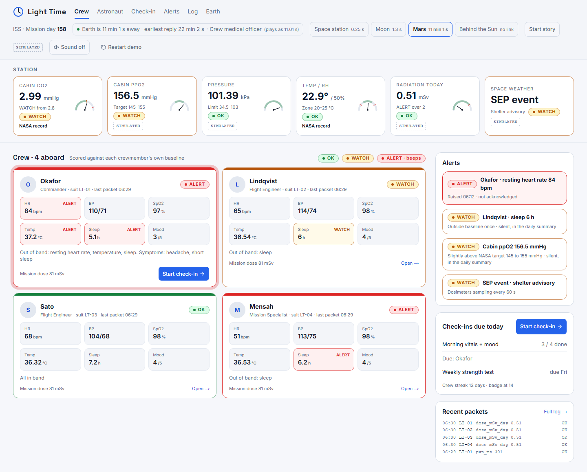
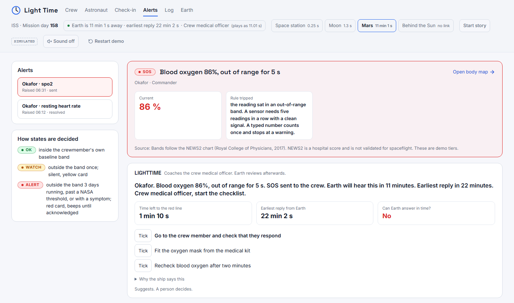
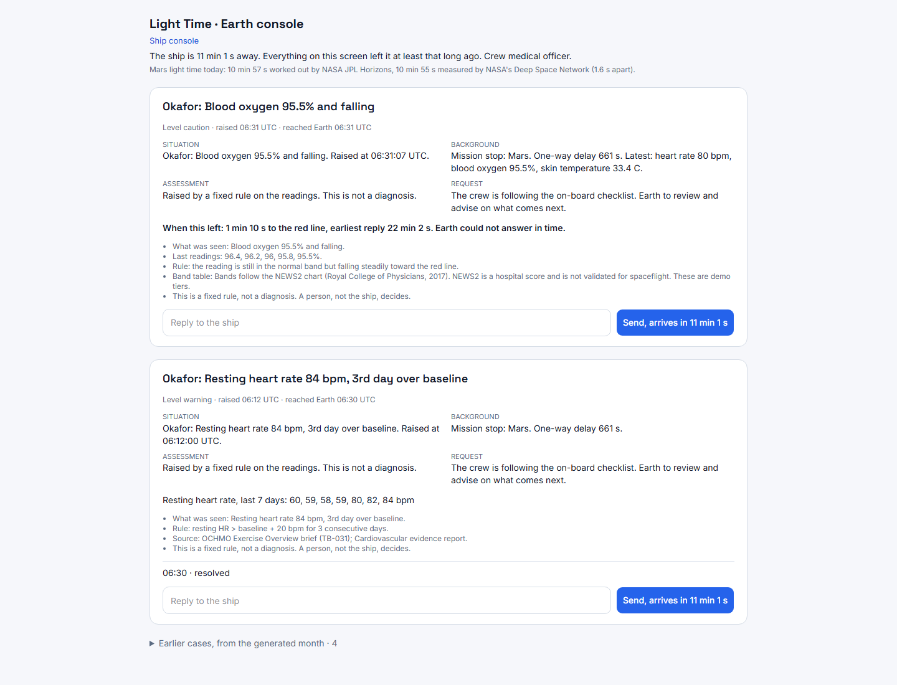
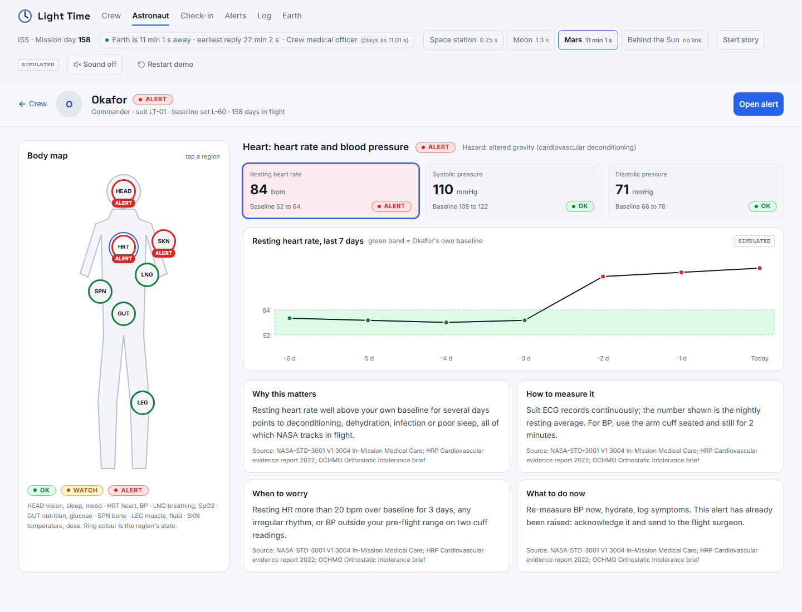
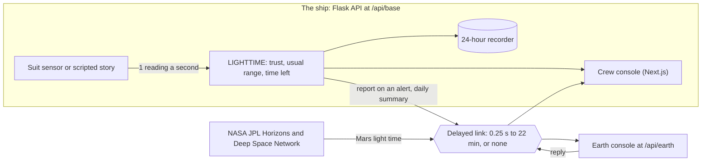
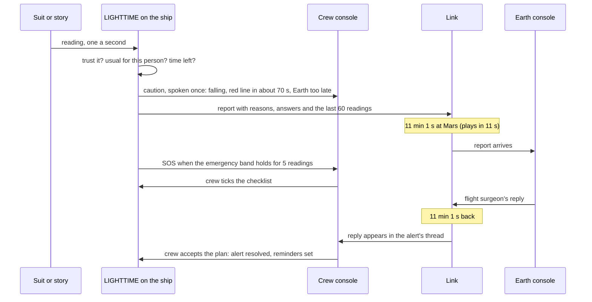

# LIGHT-TIME: project documentation

NASA Space Apps Challenge 2026. Challenge: "Create Health Monitoring Software for Astronauts on Space Missions".

This is the full description of the project: what it does, what each screen shows, how the parts fit, the API, the data and how it was tested. The reasoning and the mathematics are in [How it works](how-it-works.md). Setting it up is in the [deployment tutorial](deployment.md).

## 1. Summary

LIGHT-TIME is health monitoring software for a crew that may be minutes away from medical help, or out of contact.

On the International Space Station a flight surgeon is half a second away, there and back. From Mars the same exchange takes many minutes, 22 on the demo date of 14 November 2026, and when the Sun sits between the planets there is no link at all. Monitoring software built for the first case fails quietly in the others: it sends an alarm to someone who cannot answer in time.

LIGHT-TIME is built around that delay. It watches each crew member's readings once a second, raises an alert only on a reading it can trust, and for a falling reading works out how much time is left. It compares that with the earliest possible reply from Earth, which is twice the light time, and tells the crew in one sentence who has to act first. It then sends Earth a report that already answers the questions a flight surgeon would ask, because each question would cost another round trip.

There are two consoles. The crew console is on the ship and is always current. The Earth console shows only what the link has delivered, as old as the light time. A dial moves the ship between the space station, the Moon, Mars and behind the Sun, and everything follows it.

## 2. What you can do with it

### See the crew and the cabin at a glance

The overview shows four crew members, each scored against their own baseline and not a population average: OK inside their band, WATCH outside it once, ALERT after three days outside it, with a symptom, or past a hard limit. Above them is the cabin: carbon dioxide, oxygen, pressure, temperature and humidity, radiation dose and space weather. Every tile says whether its number is a NASA record or simulated.

### Move the ship

The header carries the dial. At the space station the delay is 0.25 s and the flight surgeon on Earth decides. At the Moon it is 1.3 s. At Mars on 14 November 2026 it is 11 minutes 1 second one way, the earliest reply is 22 minutes 2 seconds away, and the crew medical officer leads. Behind the Sun the header turns to the alert colour and reads "No link to Earth. The crew, alone", and messages wait in a queue until the link returns.

### Watch an alert cross the link

"Start story" plays a scripted fall in one crew member's blood oxygen. About half a minute in, while the reading is still in the normal band, LIGHTTIME raises a caution and speaks: the reading is falling, it reaches the red line in about 70 seconds, Earth's earliest reply is 22 minutes away, that is too late, crew medical officer, check on him now. About 13 seconds later the reading holds in the emergency band for five readings and the alert becomes an SOS.

The alert page shows the rule that tripped and its source, the LIGHTTIME card (the sentence, the time left, the earliest reply, whether Earth can answer in time, a checklist to tick and the reasons), the round trip from raised to resolved, and the thread with the flight surgeon. The three figures on the card are the ones the ship worked out when it first warned; they travel with the report so that Earth sees what the ship knew.

### Answer from Earth

The Earth console is a second page for a second person. It shows nothing until the link delivers it. Each case arrives as a handoff report: situation, background, assessment and request, the deadline as it stood when the report left, and the reasons. The reply box says how long the answer will take to arrive. A reply travels back through the same delay and appears in the alert's thread on the ship. If the link is down, the reply waits and leaves when the link returns.

In the demo a leg of a minute or more plays 60 times faster, so the 11-minute leg to Mars takes 11 seconds. The header says so ("plays as 11 s"). The true delay is what every message carries.

### Look at one person

Each crew member has a page with a body map, the day's values against their own baseline, a seven-day chart for each measure, and four short answers for each region: why it matters, how to measure it, when to worry and what to do now, each with its source.

### Do the morning check-in

A crew member records vital signs, a cuff blood pressure, mood, sleep and symptoms, and takes a short reaction-time test. The check-in goes to the ship, counts toward the crew's streak, and any symptoms are attached to that person's open alerts so that Earth sees them.

### Read the log

The log lists the last day of readings as packets, one for each sensor stream of each suit each minute, with the state of each sensor stream and a count of what has been sent to ground today. A packet with poor signal quality is marked RECHECK whatever its value.

### Connect a suit

A suit sensor (an ESP32 with a MAX30102 pulse oximeter) posts one reading a second to the ship, using its own field names. The reading appears on that crew member's card a second later and goes through the same rules. See [hardware.md](hardware.md).

## 3. How the parts fit

There are two repositories. `LightTime-backend` is the ship's computer and the link: a Flask app with a database (SQLite on a laptop, Postgres when hosted). `LightTime-frontend` is both consoles: a Next.js app that asks the ship for its state once a second.

Inside the backend, `base_station/` is the ship (readings, rules, alerts, reports, the scripted story, the daily rules, the log). `command_center/` is Earth's API. `common/` holds what both use: the tables, the link, the light time and the rule for who decides. Earth's code may read only the link's table. It cannot see a reading, an alert or a crew member unless the ship sent it and the delay has passed.

One alert, end to end:

The console has two modes. With no ship address it runs on built-in demo data, so a hosted copy always shows something. With a ship address it shows the ship's data, and if the ship cannot be reached it says so and falls back to the built-in demo.

## 4. The API

All routes return JSON. The full field list for each is the table in [the backend design](specs/2026-11-14-backend-design.md), which the console builds against and which changes in the same commit as the code.

### The ship, `/api/base`

| Route | What it does |
|---|---|
| `GET /state` | The dial stop, the delay, the round trip, who decides, LIGHTTIME's role, the mission day and the ship's clock |
| `POST /dial` | Moves the ship to another stop. Sends everything that was waiting when the link comes back |
| `POST /readings` | Stores one reading, runs the rules, returns any alert it raised. Takes the ship's field names or the suit's |
| `GET /crew`, `GET /crew/<id>` | The crew cards: today's values, each person's baseline, states, the week, the newest suit reading, the usual range |
| `GET /crew/<id>/history` | One measure for one person, day by day, with the baseline band |
| `GET /crew/<id>/readings` | Recent readings for the trend chart |
| `GET /checkins/today`, `POST /crew/<id>/checkins` | Who has checked in, the streak, and saving a check-in |
| `GET /alerts`, `GET /alerts/<id>` | Alerts with their level, reasons, deadline, checklist, timeline and who raised them |
| `POST /alerts/<id>/ack`, `/steps`, `/send`, `/clear`, `/accept-plan` | A person acknowledges, ticks a checklist step, sends the report, resolves with a note, or accepts Earth's plan |
| `GET /alerts/<id>/thread` | The messages about one alert, in both directions, with their travel times |
| `POST /sos` | A crew member presses SOS |
| `POST /messages` | Free text from the crew to the flight surgeon |
| `GET /outbox`, `GET /inbox` | What the ship has sent (queued, in flight, delivered) and what has arrived |
| `GET /reminders`, `POST /reminders/<id>/done` | Reminders set by an accepted plan |
| `GET /station`, `GET /space-weather`, `GET /habitat` | The cabin tiles, the space-weather tile, and the NASA cabin record with its source and date |
| `GET /thresholds` | The words and the source of every daily rule the console prints |
| `GET /packets`, `GET /stream-health` | The health log and the state of each sensor stream |
| `POST /summary/send` | Sends each person's daily summary to Earth |
| `POST /scenario/start`, `/scenario/stop` | Starts or stops a scripted story: `full` (the demo), `stage` (short), `real` (a recorded fall) |
| `GET /sources` | Every outside source the app uses and how fresh it is |
| `POST /reset` | Returns to the demo morning |
| `GET /health` | A liveness check |

### Earth, `/api/earth`

| Route | What it does |
|---|---|
| `GET /inbox` | Everything the link has delivered to Earth, and nothing else |
| `POST /reply` | Sends advice back through the same delay |
| `GET /outbox` | What Earth has sent, with status and time left in flight |
| `GET /network` | The Mars delay from JPL Horizons beside the figure the Deep Space Network reports |

## 5. The data

NASA and the Canadian Space Agency publish no open stream of astronaut vital signs. So crew vital signs are simulated and labelled, and real data goes into everything around the crew.

| On screen | Where it comes from | Real or simulated |
|---|---|---|
| Mars light time | NASA JPL Horizons, asked live, with dated stored values as a fallback | Real |
| The second light-time figure | NASA Deep Space Network Now feed, round-trip light time to Mars spacecraft | Real |
| Cabin carbon dioxide, temperature and humidity | NASA Open Science Data Repository, Environmental Data App, mission Rodent Research 1 on the ISS (2014), replayed | Real record, replayed |
| Cabin oxygen, pressure, radiation dose today, space weather | The generated mission month | Simulated, labelled |
| Crew daily values, baselines and the week | The generated mission month: four crew, about a month, with planted events and an answer key the ship never reads | Simulated, labelled |
| The scripted story | A script; the `real` story replays one volunteer's recorded fall in blood oxygen | Simulated; the `real` story is a research recording |
| Heart rate and skin temperature in replay mode | PPG-DaLiA wrist recordings | Research recording, labelled |
| Alert bands | NEWS2 chart, Royal College of Physicians | Published chart |
| Risk name on each alert | NASA Human Research Program risk list | Copied by hand |

The recordings used to test the rules are described in [How it works](how-it-works.md), section 5. Links, licences and the credit lines each source asks for are in [data-sources.md](data-sources.md).

The demo always starts on the same morning: 14 November 2026 at 06:30 UTC, mission day 158. The commander's resting heart rate has been above his baseline for three days and alert A1 is waiting to be acknowledged. Carbon dioxide reads 2.99 mmHg, a real NASA record, and sits in WATCH. A simulated solar particle event has a shelter advisory in force.

## 6. How it was tested

The backend has 192 automated tests, run after every task. They cover the alarm rules and their false-alarm guards, the link and its delays, queueing and release when the link returns, the field names the console depends on, the suit's field names, the health log, and a list of words the ship must never show on screen ("machine learning", "trained", "validated", "predicts illness"), because none of them is true of it.

The rules were also tested on real recordings: six induced falls in blood oxygen, a healthy night, an apnoea night and fifteen people's wrist heart rate. The results, including the two rules that were switched off because of them, are in [How it works](how-it-works.md).

The console is type-checked and linted, has unit tests for the code that turns the ship's answers into what the screens show, and was checked in a headless browser after every task of the wiring work.

Two rounds of code review were run on the backend; each finding was reproduced before it was fixed, and each fix came with a test.

## 7. Limits

This is a hackathon prototype and not a medical device. The alert bands come from a hospital chart that has not been validated for spaceflight. The checklist wording is demo text and not medical advice.

Crew vital signs are simulated or replayed from research recordings. The evidence for the time-left rule rests on six volunteers.

The hosted console shows the built-in demo until the hosted ship can be reached from a browser. A hosted ship is one ship: everyone who opens it shares the same dial and the same story.

Compressed playback means a reply at Mars arrives 22 seconds after the report left, not 22 minutes. The screens state the true delay; clock times printed beside a played leg are the demo clock's.

## 8. Built with

Backend: Python 3.12, Flask, Flask-SQLAlchemy, SQLite or PostgreSQL 16, gunicorn, pytest. Console: Next.js 16, React 19, TypeScript, zod, Tailwind CSS, Biome, Vitest, Playwright, pnpm. Hosting: Docker images on Google Cloud Run. Hardware: ESP32 with a MAX30102 pulse oximeter. Data tools: NASA JPL Horizons API, NASA Deep Space Network Now, NASA Open Science Data Repository.

## 9. Use of AI tools

AI assistants (Claude and Claude Code, from Anthropic) were used to draft designs and plans, write and review code and tests, check data and references, and write documentation. Each use is logged in `AI_USE.md` with the date and the purpose. The running application uses no AI model: no language model is called, and no trained model makes or changes a decision. The idea, the decisions and the review of every result are the team's.

## References

Each entry was opened at its publisher, NASA, PhysioNet, UCI or a DOI record on 15 November 2026.

1. Alavi A, Bogu GK, Wang M, et al. (2022). Real-time alerting system for COVID-19 and other stress events using wearable data. Nature Medicine 28(1): 175-184. https://doi.org/10.1038/s41591-021-01593-2
2. Antonsen E, Bayuse T, Blue R, et al. (2017). Evidence Report: Risk of Adverse Health Outcomes and Decrements in Performance due to In-Flight Medical Conditions. NASA Human Research Program, Exploration Medical Capabilities Element, Johnson Space Center. https://ntrs.nasa.gov/citations/20170004604
3. Badger J, Higbee D, Kennedy T, et al. (2018). Spacecraft Dormancy Autonomy Analysis for a Crewed Martian Mission. NASA/TM-2018-219965. https://ntrs.nasa.gov/citations/20180005514
4. Bureau International des Poids et Mesures. SI defining constants. https://www.bipm.org/en/measurement-units/si-defining-constants (read 15 November 2026).
5. Canadian Space Agency (2019). Canadian Healthcare in Deep Space: Advancing our country's leadership in autonomous care in space and on Earth. Report of the Expert Group on the Potential Canadian Healthcare and Biomedical Roles for Deep-Space Human Spaceflight. https://asc-csa.gc.ca/eng/publications/canadian-healthcare-in-deep-space.asp
6. Canadian Space Agency (2025). Science Community Topical Teams 2023 Report on Space Astronomy, Planetary Science and Astronaut Health. https://open.canada.ca/data/en/dataset/520fe919-0868-4086-ba3f-1964b80ec26c (Open Government Licence - Canada).
7. Canadian Space Agency. Why do we conduct science experiments in space? https://asc-csa.gc.ca/eng/iss/science/why-do-we-conduct-science-experiments-in-space.asp (modified 28 October 2025).
8. Drew BJ, Harris P, Zègre-Hemsey JK, et al. (2014). Insights into the problem of alarm fatigue with physiologic monitor devices: a comprehensive observational study of consecutive intensive care unit patients. PLoS ONE 9(10): e110274. https://doi.org/10.1371/journal.pone.0110274
9. Giorgini JD and JPL Solar System Dynamics Group. NASA/JPL Horizons On-Line Ephemeris System. https://ssd.jpl.nasa.gov/horizons/ (data retrieved 15 November 2026).
10. Görges M, Markewitz BA, Westenskow DR (2009). Improving alarm performance in the medical intensive care unit using delays and clinical context. Anesthesia and Analgesia 108(5): 1546-1552. https://doi.org/10.1213/ane.0b013e31819bdfbb
11. Hoffman JS, Viswanath VK, Tian C, Ding X, Thompson MJ, Larson EC, Patel SN, Wang EJ (2022). Smartphone camera oximetry in an induced hypoxemia study. npj Digital Medicine 5(1): 146. https://doi.org/10.1038/s41746-022-00665-y. Data: https://github.com/ubicomplab/oximetry-phone-cam-data (MIT licence).
12. Kendall MG (1938). A new measure of rank correlation. Biometrika 30(1-2): 81-93. https://doi.org/10.1093/biomet/30.1-2.81
13. Lemery J, MacNeill K, Fleming N, Easter B, Marchica A, Berens KL, Lehnhardt K (2024). Earth Independent Medical Operations (EIMO) Definition Workshop. NASA/TM-20240002454. https://ntrs.nasa.gov/citations/20240002454
14. Levin DR, Steller J, Anderson A, Lemery J, Easter B, Hilmers DC, Lehnhardt KR (2023). Enabling Human Space Exploration Missions Through Progressively Earth Independent Medical Operations (EIMO). IEEE Open Journal of Engineering in Medicine and Biology 4: 162-167. https://doi.org/10.1109/OJEMB.2023.3255513
15. Mishra T, Wang M, Metwally AA, et al. (2020). Pre-symptomatic detection of COVID-19 from smartwatch data. Nature Biomedical Engineering 4(12): 1208-1220. https://doi.org/10.1038/s41551-020-00640-6
16. NASA (2012). Fault Management Handbook. NASA-HDBK-1002, Draft 2, 2 April 2012 (not approved). https://nasa.gov/wp-content/uploads/2015/04/636372main_NASA-HDBK-1002_Draft.pdf
17. NASA (2023). NASA Spaceflight Human-System Standard, Volume 1: Crew Health. NASA-STD-3001, Volume 1, Revision C. https://www.nasa.gov/reference/nasa-std-3001v1/
18. NASA (2026). NASA Spaceflight Human-System Standard, Volume 2: Human Factors, Habitability, and Environmental Health. NASA-STD-3001, Volume 2, Revision F. https://www.nasa.gov/reference/nasa-std-3001v2/
19. NASA Community Coordinated Modeling Center. Space Weather Database Of Notifications, Knowledge, Information (DONKI). https://ccmc.gsfc.nasa.gov/tools/DONKI/ (read 15 November 2026).
20. NASA Human Research Program. Hazard: Distance From Earth. https://www.nasa.gov/hrp/hazard-distance-from-earth/ (modified 1 August 2024).
21. NASA Human Research Program. Risks of Human Spaceflight. https://www.nasa.gov/hrp/risks/ (read 15 November 2026).
22. NASA Jet Propulsion Laboratory. Astrodynamic Parameters. https://ssd.jpl.nasa.gov/astro_par.html (read 15 November 2026).
23. NASA Jet Propulsion Laboratory. Deep Space Network Now. https://eyes.nasa.gov/apps/dsn-now/ (data feed https://eyes.nasa.gov/dsn/data/dsn.xml, read 15 November 2026).
24. NASA Office of the Chief Health and Medical Officer (2023). Environmental Control and Life Support System (ECLSS): Human-Centered Approach. OCHMO-TB-002, Revision B. https://www.nasa.gov/wp-content/uploads/2023/12/ochmo-tb-002-eclss.pdf
25. NASA Office of the Chief Health and Medical Officer (2023). Exercise Overview. OCHMO-TB-031. https://www.nasa.gov/wp-content/uploads/2023/12/ochmo-tb-031-exercise-overview.pdf
26. NASA Office of the Chief Health and Medical Officer (2025). Design for Ionizing Radiation Protection. OCHMO-TB-020, Revision G. https://www.nasa.gov/wp-content/uploads/2023/12/ochmo-tb-020-radiation-protection.pdf
27. NASA Office of the Chief Health and Medical Officer. Bone Loss. OCHMO-MTB-013, Revision D. https://www.nasa.gov/wp-content/uploads/2026/02/ochmo-mtb-013-bone-loss.pdf
28. NASA Office of the Chief Health and Medical Officer. Carbon Dioxide (CO2). OCHMO-TB-004, Revision D. https://www.nasa.gov/wp-content/uploads/2023/12/ochmo-tb-004-carbon-dioxide.pdf
29. NASA Open Science Data Repository. Environmental Data App (EDA), mission RR-1 (Rodent Research 1). https://visualization.osdr.nasa.gov/eda/ (read 15 November 2026).
30. NASA Space Science Data Coordinated Archive (2024). Moon Fact Sheet. https://nssdc.gsfc.nasa.gov/planetary/factsheet/moonfact.html
31. NASA Space Science Data Coordinated Archive (2025). Mars Fact Sheet. https://nssdc.gsfc.nasa.gov/planetary/factsheet/marsfact.html
32. Penzel T, Moody GB, Mark RG, Goldberger AL, Peter JH (2000). The Apnea-ECG Database. Computers in Cardiology 27: 255-258. https://doi.org/10.1109/CIC.2000.898505. Data: Apnea-ECG Database v1.0.0, PhysioNet, https://doi.org/10.13026/C23W2R (Open Data Commons Attribution License v1.0).
33. Pollard T, Moody BE, Lehman L-wH, Gow BJ, Fernandes C, Xie C, Johnson A, Mark RG, Heldt T (2026). PhysioNet as a global platform for biomedical research. Nature Health 1(8): 792-795. https://doi.org/10.1038/s44360-026-00096-z
34. Rader SN, Reagan ML, Janoiko B, Johnson JE (2013). Human-in-the-Loop Operations over Time Delay: NASA Analog Missions Lessons Learned. 43rd International Conference on Environmental Systems, Vail, Colorado. AIAA 2013-3520. https://doi.org/10.2514/6.2013-3520. Full text: https://ntrs.nasa.gov/citations/20130011552
35. Reiss A, Indlekofer I, Schmidt P, Van Laerhoven K (2019). Deep PPG: Large-Scale Heart Rate Estimation with Convolutional Neural Networks. Sensors 19(14): 3079. https://doi.org/10.3390/s19143079. Data: PPG-DaLiA, UCI Machine Learning Repository, https://doi.org/10.24432/C53890 (CC BY 4.0).
36. Rousseeuw PJ, Leroy AM (1987, reprinted 2003). Robust Regression and Outlier Detection. New York: Wiley. Pages 67 and 164 give the breakdown point of the median-of-slopes line.
37. Royal College of Physicians (2017). National Early Warning Score (NEWS) 2: Standardising the assessment of acute-illness severity in the NHS. Updated report of a working party. London: RCP. https://www.rcp.ac.uk/improving-care/resources/national-early-warning-score-news-2/
38. Sen PK (1968). Estimates of the regression coefficient based on Kendall's tau. Journal of the American Statistical Association 63(324): 1379-1389. https://doi.org/10.1080/01621459.1968.10480934
39. Theil H (1950). A rank-invariant method of linear and polynomial regression analysis, I, II and III. Proceedings of the Koninklijke Nederlandse Akademie van Wetenschappen 53: 386-392, 521-525, 1397-1412.
40. Valinia A, Allen JR, Francisco DR, Minow JI, Pellish JA, Vera AH (2022). Safe Human Expeditions Beyond Low Earth Orbit (LEO). NASA/TM-20220002905, NESC-RP-20-01589. https://ntrs.nasa.gov/citations/20220002905
