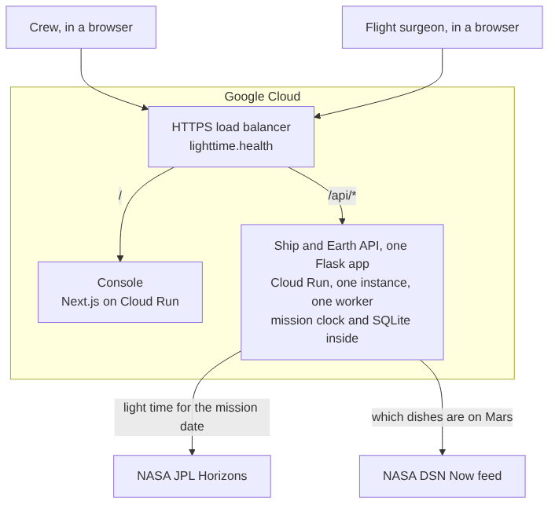
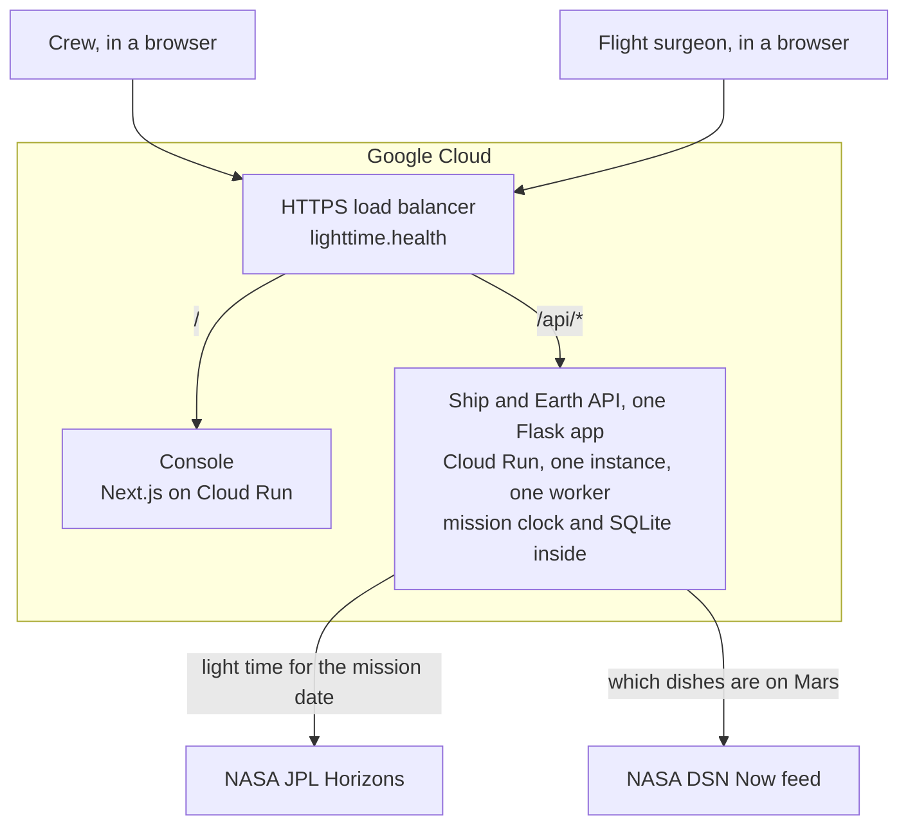
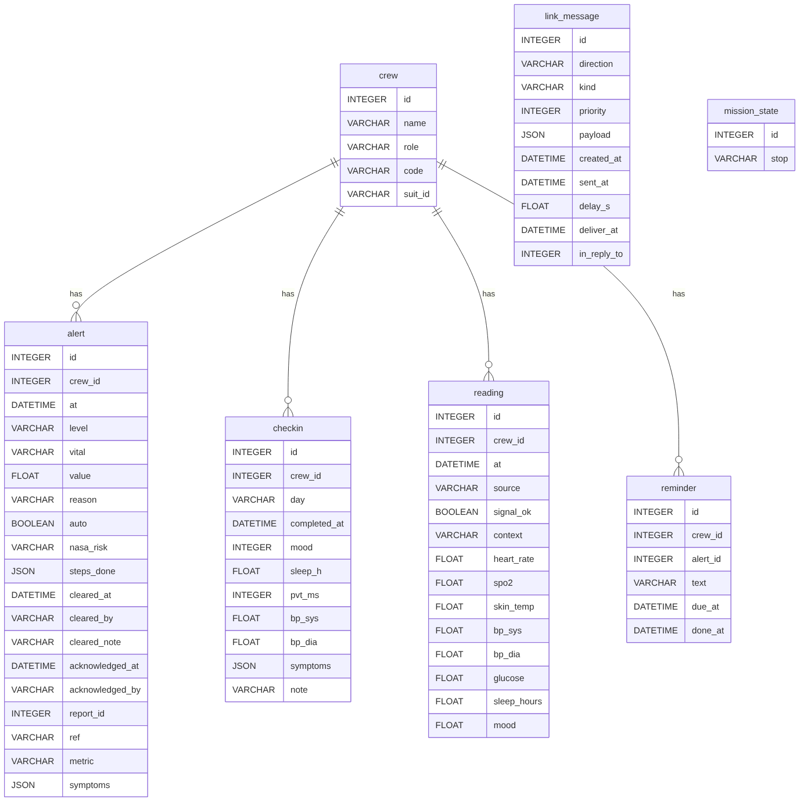
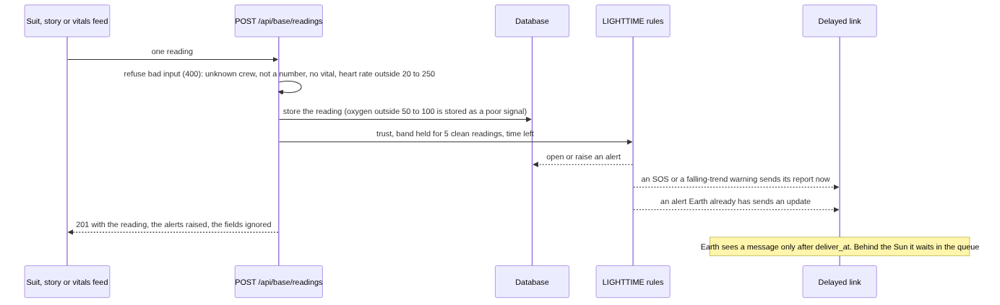
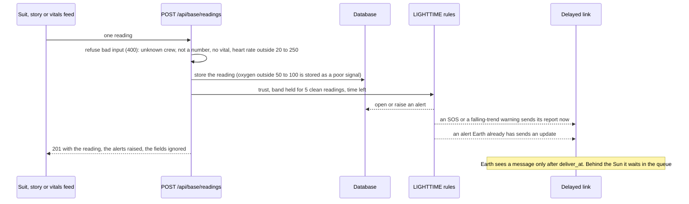
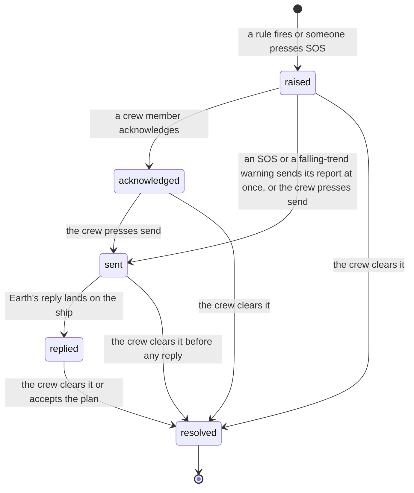

# Architecture

This page is for developers and reviewers. It covers how LIGHT-TIME is hosted, what each part does, the tables, the path of one reading, the life of an alert, the mission clock and the delayed link. The math behind the rules (light time, the trust rules, the time-left line) is in the [concept document](../concept.md), and every route is listed in the [API reference](api.md).

## Context

LIGHT-TIME is two consoles and a link between them. The backend in this repository is the ship's computer and the delayed link to Earth: one Flask app that serves the ship under `/api/base` and Earth under `/api/earth`. The console is a Next.js app in the `LightTime-frontend` repository. It has a crew side (`/base-station`) and an Earth side (`/command-center`), and it polls the API once a second.

The diagram shows the setup that [the hosted-site plan](../build-log/plans/2026-11-15-hosted-site.md) and [the deployment tutorial](../deployment.md) describe: the load balancer sends `/api/*` to the backend's Cloud Run service and everything else to the console's, the backend runs as one always-on instance with one gunicorn worker (`Dockerfile`), and with no `DATABASE_URL` it keeps its tables in SQLite inside the instance. These are the documented settings; they were not read from the live project for this page. Confirm them with the `gcloud run services describe` commands in [Plan C, Task C3 Step 2](../build-log/plans/2026-11-15-docs-c-technical.md) before relying on them. If the ship has a `DATABASE_URL` or more than one instance, the box above is wrong.

The ship's code asks two outside services for data, and both have a fallback. NASA JPL Horizons gives the one-way light time to Mars for a date (`common/lighttime.py`); if it cannot be reached, the values read on 13 November are used and labelled. The NASA DSN Now feed gives the round-trip light time NASA reports for spacecraft at Mars, as a second check (`common/dsn.py`); if it cannot be reached, the Earth console says so.

## The parts

| Part | Folder | What it does |
|---|---|---|
| The ship | [`base_station/`](../../base_station) | Takes readings, runs the LIGHTTIME rules, raises alerts, builds the report and the spoken line, plays the scripted story, and serves the crew console's data under `/api/base` |
| Earth | [`command_center/`](../../command_center) | Builds the flight surgeon's cases from what the link has delivered, takes replies, runs the vitals feed, and serves `/api/earth` |
| Shared | [`common/`](../../common) | The tables, the delayed link, Mars light time, the DSN check, the dial and the who-decides rule, the dataset reader |
| The console | `LightTime-frontend` repository | The crew and Earth screens. It reads the API and holds no state of its own beyond the screen |

Earth's code may read only the link and the dial, never the ship's own tables or code. [`tests/test_wall.py`](../../tests/test_wall.py) fails if any file in `command_center/` imports from `base_station` or imports `Crew`, `Reading`, `Alert`, `Checkin` or `Reminder`. In the demo both sides run in one process and share one database, so this rule, and the link's `deliver_at` filter, are what keep Earth from seeing anything early.

## Data model

The diagram is generated from the SQLAlchemy tables by `scripts/api_reference.py` into [`docs/diagrams/data-model.mmd`](../diagrams/data-model.mmd). The tables are defined in [`common/models.py`](../../common/models.py).

| Table | Holds |
|---|---|
| `crew` | The four crew members, seeded from `data/processed/reference/crew.csv`: code (`C1`), name, role, suit id |
| `reading` | One set of numbers for one person at one time, from a suit, the story, a replay, the vitals feed or a check-in (`source`), with `signal_ok` |
| `alert` | Something the ship noticed about one vital of one person: level, reason, checklist steps done, who acknowledged and cleared it, and the id of the report sent to Earth |
| `checkin` | One row per person per day: mood, sleep, symptoms, optional cuff blood pressure and reaction time |
| `reminder` | Follow-up tasks made when the crew accepts the flight surgeon's plan |
| `mission_state` | One row: where the dial is |
| `link_message` | Every message in either direction, with `sent_at`, `delay_s` and `deliver_at` |

## The path of one reading

The route is `post_reading()` and the work is `ingest()`, both in [`base_station/routes.py`](../../base_station/routes.py); the rules are `evaluate()` in [`base_station/rules.py`](../../base_station/rules.py). Three details matter:

- The route accepts the suit firmware's field names (`astronaut_id`, `heart_rate_bpm`, `spo2_percent`, `skin_temp_c`) as well as the ship's own, and lists any field it did not use under `ignored`.
- A blood-oxygen value outside 50 to 100 is not refused. It is stored with `signal_ok` false, so it is kept but never judged, and the ten readings after it cannot alarm while the sensor settles.
- Two kinds of alert send their report to Earth without waiting for anyone: an emergency (SOS) and a reading that is still normal but falling toward its red line. Any other alert leaves when a crew member presses send.

One reading a second goes to this route. Data that arrives once a minute (the suits' minute file) goes to the health log instead, never here.

## The life of an alert

The stage is never stored. `stage()` in [`base_station/routes.py`](../../base_station/routes.py) works it out from the timestamps each time an alert is read: resolved if it has been cleared, replied if a reply about it has landed, sent if its report has left, acknowledged if someone acknowledged it, otherwise raised. So a report waiting in the queue behind the Sun has no `sent_at`, and its alert stays raised or acknowledged until the dial moves to a stop with a link.

Each alert also carries a `timeline` for the stepper on the alert screen: when it was raised, acknowledged and sent, when the report lands on Earth, the earliest possible reply (landing time plus one more leg, as if the flight surgeon answered at once), when the reply landed and when it was resolved. `accept-plan` works only once the alert is replied; it resolves the alert and makes four "Take temperature" reminders four hours apart.

## The mission clock and the delayed link

### One process holds the clock

The ship's clock is real time plus an offset (`utcnow()` and `set_clock()` in [`common/models.py`](../../common/models.py)). With `LIGHTTIME_MORNING=1`, the app loads the demo morning at start and on every reset ([`base_station/morning.py`](../../base_station/morning.py)): 14 November 2026 at 06:30 UTC, mission day 158, with alert A1 just raised. The offset lives in the process's memory, so the app must run as one process with one worker. A second worker would run a second clock. See [ADR 0002](../adr/0002-one-process-holds-the-clock.md).

### The link

[`common/link.py`](../../common/link.py) is the whole link. `send()` stamps a message with `sent_at` and `deliver_at` if the link is up, or leaves it in the queue if it is not. `delivered()` returns only messages whose `deliver_at` has passed, and that is the only way either side reads the other's messages. When the dial moves from behind the Sun to a stop with a link, `flush_queue()` sends everything that waited, most urgent first, 0.4 seconds apart. The priorities are: reports, an SOS escalation and Earth's replies 0, other updates 1, crew messages 2, daily summaries 3, the vitals feed 9.

### Long legs play sixty times faster

A leg of a minute or more plays 60 times faster on the demo clock, so the 660.86-second leg to Mars on 14 November plays as 11.01 seconds (`real_delay_s()`). Legs under a minute (the station at 0.25 seconds, the Moon at 1.3 seconds) play at true length. The stamps (`sent_at`, `deliver_at`) are on the demo clock; the fields `delay_s`, `arrives_after_s`, `earliest_reply_after_s` and `eta_s` are true mission seconds, so the screens can say "11 minutes" while the message lands 11 seconds later. See [ADR 0005](../adr/0005-long-legs-play-sixty-times-faster.md).

### Who decides

`mode_for()` in [`common/modes.py`](../../common/modes.py): with no link, the crew alone; with a one-way delay of 300 seconds or more, the crew medical officer first; otherwise the flight surgeon on Earth, live. The 300-second switch follows NASA's NEEMO 16 analog mission; the exact number is a design choice.

### The vitals feed

Besides reports and updates, Earth can receive a routine feed of the crew's vitals ([`command_center/feed.py`](../../command_center/feed.py)). `POST /api/earth/feed/start` starts it, `POST /api/earth/feed/stop` stops it, and `GET /api/earth/feed` shows whether it runs. Each tick, every 120 seconds by default (5 to 3600 allowed, set with `{"interval_s": ...}`), takes one row per crew member from the simulated suit minute file for that time of day. It hands each reading to the ship through `POST /api/base/readings`, as a suit would, so the ship's rules run on it. It then sends the round to Earth as one link message of kind `vitals`, with the same light delay as everything else and priority 9, so after a blackout it lands behind every SOS and report. Earth keeps every tick it receives (`GET /api/earth/vitals`); the ship's recorder keeps 24 hours and drops older readings when the daily summary is sent. Every value is labelled simulated.

## Decisions

| ADR | Decision |
|---|---|
| [0001](../adr/0001-rules-decide-learned-models-advise.md) | Rules decide; a learned model may only advise |
| [0002](../adr/0002-one-process-holds-the-clock.md) | One process holds the mission clock |
| [0003](../adr/0003-sqlite-inside-the-instance.md) | The hosted ship keeps its tables in SQLite inside its one instance |
| [0004](../adr/0004-the-viewer-header-is-a-view-not-a-login.md) | The viewer header shapes a view; it is not a login |
| [0005](../adr/0005-long-legs-play-sixty-times-faster.md) | Legs of a minute or more play sixty times faster |
